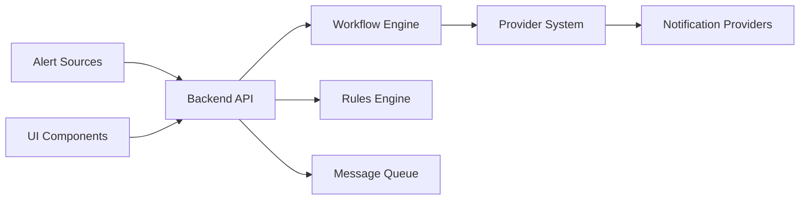

# keephq/keep

> Open alert management and AIOps platform, aggregating monitoring tools and YAML workflows.

## The problem
Alerts arrive from dozens of monitoring tools, duplicated, with no correlation or consistent automation.

## What it actually does
Centralizes alerts and incidents in one UI: deduplication, correlation, filtering, enrichment.
Declarative YAML workflows (triggers, steps, actions) in the style of GitHub Actions: e.g. a Jira ticket on a critical Sentry alert.
Connectors: Prometheus, Datadog, Grafana, PagerDuty, Slack, Jira, databases, Kafka/SQS queues…
LLM-based correlation and summarization (OpenAI, Anthropic, Ollama, LlamaCPP…).

## How it is wired

## Trying it
No command in the README: it points to the Docker Compose, Kubernetes, ECS and OpenShift guides.

## Cost and gotchas
Free when self-hosted; AI enrichments consume your LLM keys.
License present but not identified by GitHub: to be checked.

## What it is not
Not a monitoring tool: it does not collect metrics, it consumes other tools' alerts.
The "Enterprise Ready" claim (SSO, RBAC) is not detailed for the free edition.

## Alternatives
No alternative named in the README.

## For you
Worth watching if you operate models in production with several alert sources: the YAML workflows are reusable, but check the license first.
