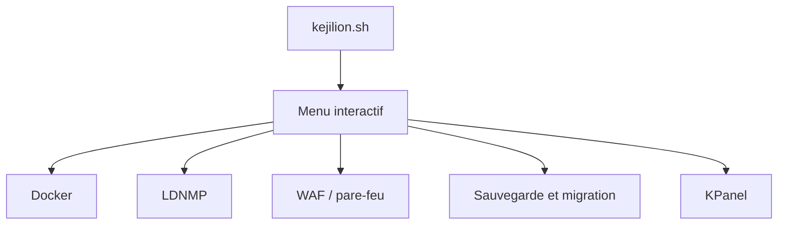

# kejilion/sh

> Shell script toolbox for administering a Linux server: Docker, websites, backups, security.

## The problem
Administering a Linux server means juggling tools: Docker, a Nginx/MySQL/PHP stack, firewall, backups, network tests.

## What it actually does
An interactive script that shows system status, tests the network, manages Docker containers and images, deploys an LDNMP stack (Nginx, MySQL, PHP, Redis), protects sites (CC, firewall, WAF) and backs up or migrates sites and databases. An app marketplace and the KPanel web panel are included. The WAF receives its rules through a signed package, with verification and rollback commands.

## How it is wired
Simplified diagram based on the sheet, no diagram provided.


## Trying it
```bash
bash <(curl -sL kejilion.sh) en
bash <(curl -sL kejilion.sh) app kpanel
k web waf package-check
```

## Cost and gotchas
Free. Run as `root`: the script modifies the network, firewall and disks. Back up before anything. The README is in Chinese, with passages in English.

## What it is not
Not a risk-free tool: running a remote script as root puts your server at stake. Not designed for workstations. No documented equivalent for a reproducible infrastructure-as-code deployment.

## Alternatives
No alternative named in the README.

## For you
Ignore: an all-in-one root script maintained by one person does not suit a reproducible MLOps infrastructure.
