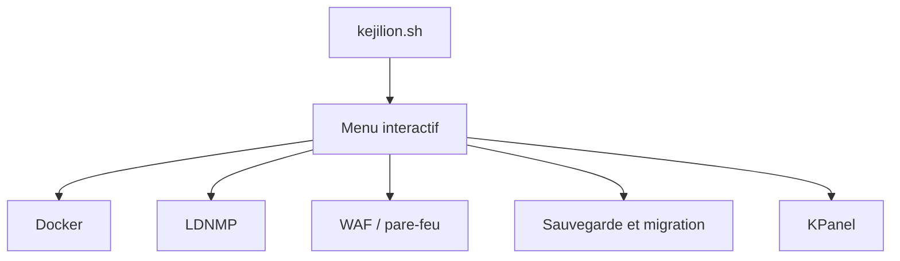

# kejilion/sh

> Boîte à outils de scripts shell pour administrer un serveur Linux : Docker, sites web, sauvegardes, sécurité.

## Le problème
Administrer un serveur Linux demande de jongler entre outils : Docker, pile Nginx/MySQL/PHP, pare-feu, sauvegardes, tests réseau.

## Ce que ça fait vraiment
Un script interactif qui affiche l'état du système, teste le réseau, gère conteneurs et images Docker, déploie une pile LDNMP (Nginx, MySQL, PHP, Redis), protège les sites (CC, pare-feu, WAF) et sauvegarde ou migre sites et bases. Un marché d'applications et le panneau web KPanel sont inclus. Le WAF reçoit ses règles par un paquet signé, avec commandes de vérification et de retour arrière.

## Comment c'est branché
Schéma simplifié d'après la fiche, sans diagramme fourni.


## Essayer
```bash
bash <(curl -sL kejilion.sh) en
bash <(curl -sL kejilion.sh) app kpanel
k web waf package-check
```

## Coût et pièges
Gratuit. À lancer en `root` : le script modifie le réseau, le pare-feu et les disques. Sauvegarder avant tout. Le README est en chinois, avec des passages en anglais.

## Ce que ce n'est pas
Pas un outil sans risque : exécuter un script distant en root engage ton serveur. Pas conçu pour des postes de travail. Pas d'équivalent documenté pour un déploiement reproductible type infrastructure en code.

## Alternatives
Aucune alternative nommée dans le README.

## Pour toi
À ignorer : un script tout-en-un en root maintenu par une personne ne convient pas à une infrastructure MLOps reproductible.

