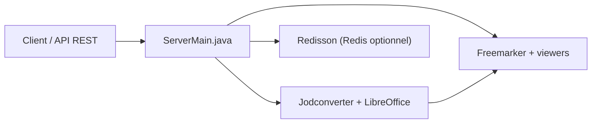

# kekingcn/kkFileView

> Spring Boot server for online preview of documents, images, CAD and archives, embeddable through a REST API.

## The problem
Displaying a large number of formats (Office, PDF, OFD, CAD…) in a web page without opening them locally.

## What it actually does
Receives a file URL, converts it on the server side (LibreOffice/OpenOffice via Jodconverter for Office, PDF, images…) and renders a preview page. Handles more than twenty format families: Office, WPS, 3D, CAD, mail, epub, archives, video. Redis is optional. The history shows many security fixes (SSRF, path traversal, XSS).

## How it is wired


## Trying it
```bash
git pull https://github.com/kekingcn/kkFileView.git
# Lancer la méthode main de /server/src/main/java/cn/keking/ServerMain.java
# puis ouvrir http://localhost:8012/
```

## Cost and gotchas
Free. JDK 21 minimum (5.0.x release notes). LibreOffice is installed automatically on Linux, manually on macOS. On 5.0.2 and earlier, upgrading is strongly advised because of security flaws.

## What it is not
Not an editor. Not a viewer ready to expose on the Internet without hardening. License absent from the catalog.

## Alternatives
None cited in the README.

## For you
Watch: useful if you must give a document preview in an internal app, but undeclared license and a security record to check.
