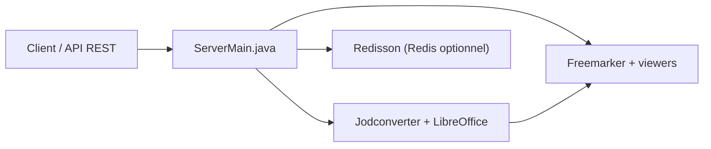

# kekingcn/kkFileView

> Serveur Spring Boot de prévisualisation en ligne de documents, images, CAO et archives, intégrable par API REST.

## Le problème
Afficher dans une page web un grand nombre de formats (Office, PDF, OFD, CAD…) sans les ouvrir en local.

## Ce que ça fait vraiment
Reçoit une URL de fichier, le convertit côté serveur (LibreOffice/OpenOffice via Jodconverter pour Office, PDF, images…) et rend une page d'aperçu. Gère plus de vingt familles de formats : Office, WPS, 3D, CAD, mail, epub, archives, vidéo. Redis est optionnel. L'historique montre de nombreux correctifs de sécurité (SSRF, traversée de chemin, XSS).

## Comment c'est branché


## Essayer
```bash
git pull https://github.com/kekingcn/kkFileView.git
# Lancer la méthode main de /server/src/main/java/cn/keking/ServerMain.java
# puis ouvrir http://localhost:8012/
```

## Coût et pièges
Gratuit. JDK 21 minimum (notes de version 5.0.x). LibreOffice est installé automatiquement sur Linux, à la main sur macOS. Sur 5.0.2 et avant, mise à niveau fortement conseillée pour des failles de sécurité.

## Ce que ce n'est pas
Pas un éditeur. Pas une visionneuse prête à exposer sur Internet sans durcissement. Licence absente du catalogue.

## Alternatives
Aucune citée dans le README.

## Pour toi
Surveiller : utile si tu dois donner un aperçu de documents dans une appli interne, mais licence non déclarée et passif sécurité à contrôler.

