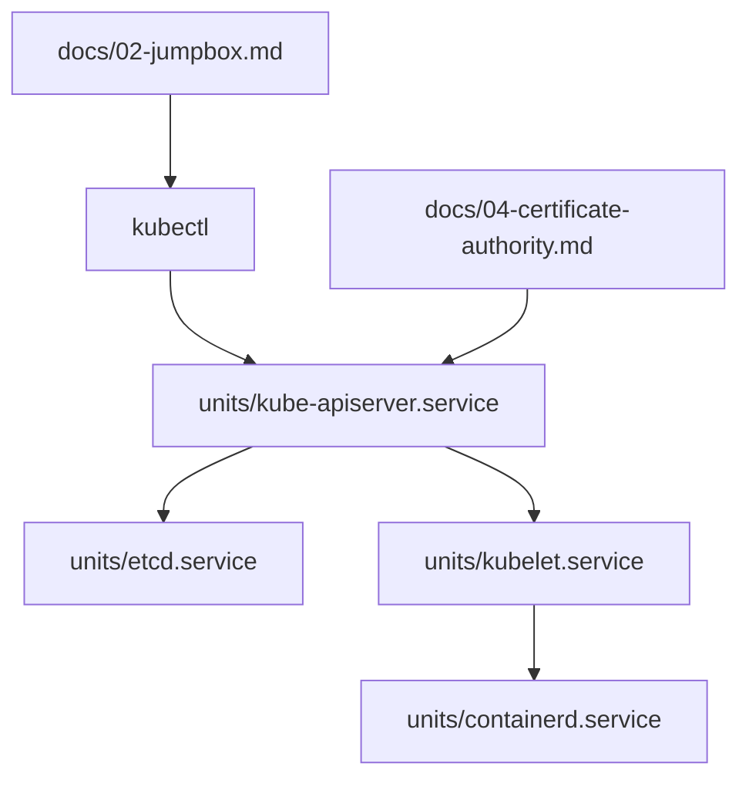

# kelseyhightower/kubernetes-the-hard-way

> A tutorial that sets up a Kubernetes cluster manually to understand each component.

## The problem
The automated tools obscure how a Kubernetes cluster is actually constructed, which makes it difficult to troubleshoot.

## What it actually does
A series of labs on four ARM64 or AMD64 machines: jumpbox, resources, certification authority and TLS, kubeconfig files, data encryption, etcd, control plane, compute nodes, kubectl, pod network routes, and smoke testing. Announced versions: Kubernetes 1.32, containerd 2.1, CNI 1.6, etcd 3.6. The diagram provided cites other versions, which are older: do not trust them.

## How it is wired

## Trying it
There is no single command in the README: follow the labs in order, from "Prerequisites" to "Cleaning Up".

## Cost and gotchas
Four machines (either virtual or physical), meaning both time and potentially a cloud bill. The final push will be in April 2025.

## What it is not
This is not a cluster installation or a production environment: the README clearly states this. Limited community support is available.

## Alternatives
No alternative is specified in the README file.

## For you
Excellent for understanding Kubernetes if you're working with MLOps; use it and experiment with it once, using disposable virtual machines.
