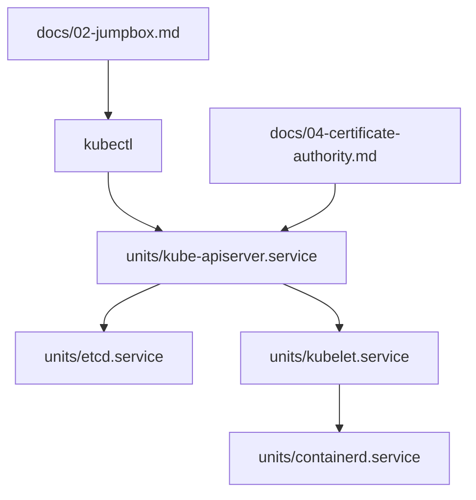

# kelseyhightower/kubernetes-the-hard-way

> Tutoriel qui monte un cluster Kubernetes à la main pour comprendre chaque composant.

## Le problème
Les outils automatiques cachent comment un cluster Kubernetes est réellement assemblé, donc on le dépanne mal.

## Ce que ça fait vraiment
Série de labs sur quatre machines ARM64 ou AMD64 : jumpbox, ressources, autorité de certification et TLS, fichiers kubeconfig, chiffrement des données, etcd, plan de contrôle, nœuds de calcul, kubectl, routes réseau des pods, test de fumée. Versions annoncées : Kubernetes 1.32, containerd 2.1, CNI 1.6, etcd 3.6. Le diagramme fourni cite d'autres versions, plus anciennes : à ne pas croire.

## Comment c'est branché

## Essayer
Aucune commande unique dans le README : suivre les labs dans l'ordre, du « Prerequisites » au « Cleaning Up ».

## Coût et pièges
Quatre machines (virtuelles ou physiques), donc du temps et éventuellement une facture cloud. Dernier push en avril 2025.

## Ce que ce n'est pas
Pas un installateur de cluster ni une base de production : le README le dit. Support communautaire limité.

## Alternatives
Aucune alternative nommée dans le README.

## Pour toi
Excellent pour comprendre Kubernetes si tu fais du MLOps ; surveille-le et fais-le une fois, avec des VM jetables.

