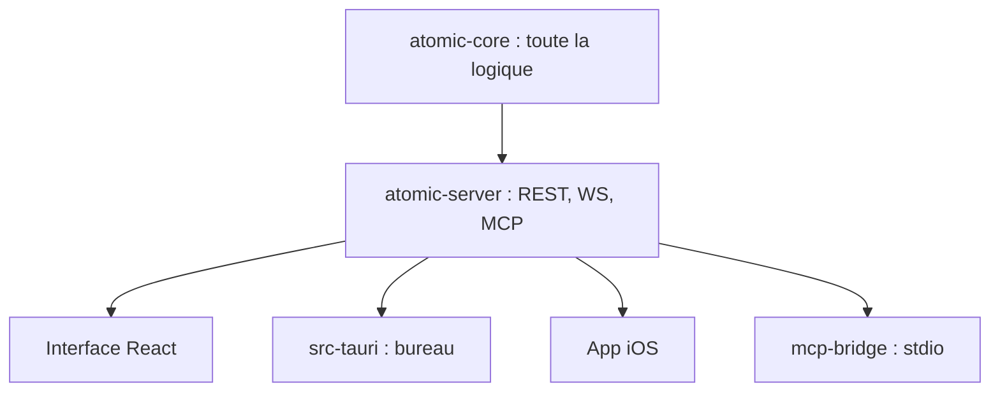

# kenforthewin/atomic

> Personal knowledge base: markdown notes linked by similarity, with synthesis, chat and an MCP server.

## The problem
Scattered notes are hard to find again: keyword search misses the links in meaning between them.

## What it actually does
Each note (atom) is chunked, vectorized, tagged and linked to nearby notes. The app offers semantic search (sqlite-vec), a graph canvas, synthesized wiki articles with citations, scheduled reports and an agentic RAG chat. It ingests RSS feeds, has a browser extension and exposes an MCP endpoint. Embeddings and LLM come from OpenRouter, Ollama or an OpenAI-compatible API.

## How it is wired


## Trying it
```bash
git clone https://github.com/kenforthewin/atomic.git
cd atomic
echo "ATOMIC_SETUP_TOKEN=$(openssl rand -base64 24)" > .env
docker compose up -d
```

## Cost and gotchas
An AI provider is required for embeddings, tags, wiki and chat: an API key or local Ollama. A hosted cloud offer exists in addition to self-hosting.

## What it is not
Not a simple note editor: without an AI provider, the key features do not run. No quantified comparison in the README.

## Alternatives
No alternative named in the README.

## For you
Keep an eye on it: the atoms plus MCP idea is useful for a personal base, but a single author and a Rust, React and Tauri stack call for a cautious trial.
