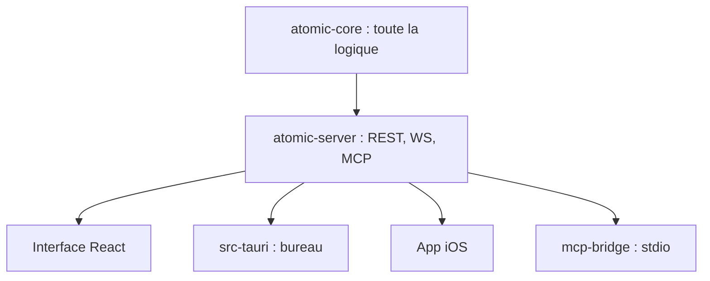

# kenforthewin/atomic

> Base de connaissances personnelle : notes markdown reliées par similarité, avec synthèse, chat et serveur MCP.

## Le problème
Des notes éparses se retrouvent mal : la recherche par mots-clés manque les liens de sens entre elles.

## Ce que ça fait vraiment
Chaque note (atome) est découpée, vectorisée, étiquetée et reliée aux notes proches. L'appli propose recherche sémantique (sqlite-vec), canevas en graphe, articles wiki synthétisés avec citations, rapports planifiés et chat RAG agentique. Elle prend les flux RSS, une extension navigateur et expose un endpoint MCP. Embeddings et LLM viennent d'OpenRouter, Ollama ou d'une API compatible OpenAI.

## Comment c'est branché


## Essayer
```bash
git clone https://github.com/kenforthewin/atomic.git
cd atomic
echo "ATOMIC_SETUP_TOKEN=$(openssl rand -base64 24)" > .env
docker compose up -d
```

## Coût et pièges
Un fournisseur d'IA est nécessaire pour embeddings, étiquettes, wiki et chat : clé d'API ou Ollama local. Une offre cloud hébergée existe en plus de l'auto-hébergement.

## Ce que ce n'est pas
Pas un simple éditeur de notes : sans fournisseur d'IA, les fonctions clés ne tournent pas. Pas de comparaison chiffrée dans le README.

## Alternatives
Aucune alternative nommée dans le README.

## Pour toi
À surveiller : l'idée atomes plus MCP est utile pour une base personnelle, mais un seul auteur et une pile Rust, React et Tauri imposent un essai prudent.

