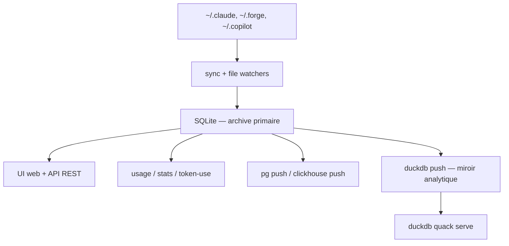

# kenn-io/agentsview

> Local archive, search and accounting of the sessions of all your coding agents.

## The problem
Each coding agent (Claude, Codex, Copilot, OpenCode, Aider, Antigravity) writes its sessions in its own format, in its own place.
Impossible to find a conversation from three weeks ago, or to know what the month cost.

## What it actually does
On first launch it discovers the sessions of every agent present on the machine, syncs them into a local SQLite and serves a web UI on `127.0.0.1:8080`.
`agentsview usage daily` computes cost per day, per model and per agent, with LiteLLM/OpenRouter pricing and an offline fallback, taking cache tokens into account.
Search is full-text (FTS5, with Chinese segmentation) and optionally semantic via any OpenAI-compatible embeddings endpoint.
`agentsview stats` outputs windowed analytics as versioned JSON: session archetypes, duration distributions, peak context, cache economics.

## How it is wired


## Trying it
```bash
curl -fsSL https://agentsview.io/install.sh | bash
agentsview serve           # serveur au premier plan
agentsview daemon start    # ou en arrière-plan
agentsview session list
agentsview usage daily --breakdown
```

## Cost and gotchas
Free and local. The server binds to loopback and validates the `Host` header: behind an SSH port-forward or a proxy, you need `--public-url`, otherwise API calls fail with a 403.
In Docker, only the directories you explicitly mount are discovered; the container runs as root, so use a named volume rather than a bind mount.

## What it is not
It is not a service: nothing leaves your machine unless you enable a PostgreSQL/ClickHouse push or a Gist export.
DuckDB is only a read mirror, not a replacement for SQLite. Aider and JetBrains Copilot sessions require manual work (opt-in scan, third-party exporter).

## Alternatives
- `copilot-jetbrains-exporter`: cited for exporting JetBrains Copilot sessions, which agentsview does not read directly.
- `mjacobs/agy-reader`: cited for unlocking the full transcripts of Antigravity CLI.

## For you
Adopt it: it is the only place where the real cost of all your agents combined becomes a single number.
