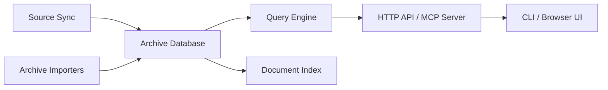

# kenn-io/msgvault

> Local archive of emails, chats, meetings, calendars and contacts, queryable via CLI, web or MCP.

## The problem
Communication history is scattered across several providers and hard to search, back up or link to people.

## What it actually does
Syncs or imports messages, meetings, calendars and contacts into a local database (SQLite, DuckDB), with attachments. Keyword search, optional semantic search and text extraction from documents. Identity resolution to group the addresses of the same person, CardDAV, export, backup and deletion review. Interfaces: browser, TUI, CLI, HTTP API, MCP server.

## How it is wired


## Trying it
```bash
curl -fsSL https://msgvault.io/install.sh | bash
msgvault init-db
msgvault add-account you@gmail.com
msgvault sync-full you@gmail.com --limit 100
msgvault serve
```

## Cost and gotchas
Gmail requires creating OAuth credentials. The optional AI features send selected data to the configured endpoints. Alpha software: storage format and CLI may change.

## What it is not
Not an email client nor a hosted service. Remote deletion is explicit and does not destroy the archive.

## Alternatives
- No alternative named in the README.

## For you
Worth watching: useful to give an agent local access to your emails, but alpha and highly sensitive data.
