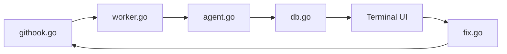

# kenn-io/roborev

> Continuous background code review, commit by commit, for people who code with AI agents.

## The problem
Agents write code fast and defects pile up before human review; copying review feedback back to the agent is manual.

## What it actually does
A post-commit hook queues each commit; a local daemon launches a coding agent (Claude Code, Codex, Gemini, Copilot, etc.) that reviews the diff. Results appear in a TUI or a local web interface. `roborev fix` sends the findings back to an agent that fixes and commits, `roborev refine` loops in an isolated worktree. Targeted analyses (duplication, complexity, security…) and JSON export.

## How it is wired


## Trying it
```bash
curl -fsSL https://roborev.io/install.sh | bash
cd your-repo
roborev init
git commit -m "..."
roborev tui
```

## Cost and gotchas
No hosted service, but each review consumes the quotas or the bill of the configured agent. Anonymous PostHog telemetry is enabled by default (`ROBOREV_TELEMETRY_ENABLED=0` to turn it off). Use on trusted code only: otherwise, sandbox it.

## What it is not
Not a deterministic linter: findings come from an LLM, hence the `compact` command to filter out false positives. It is not a hosted PR review.

## Alternatives
No alternative named in the README.

## For you
Worth adopting on a trial basis: MIT, local, a concrete fix/refine loop for anyone coding with agents; check the agent bill and turn off telemetry if needed.
