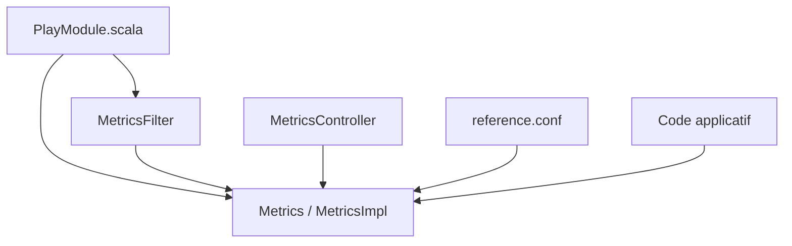

# kenshoo/metrics-play

> Scala module that plugs the Dropwizard Metrics library into a Play 2 application.

## The problem
Instrumenting a Play application with JVM, HTTP and custom metrics requires glue code.

## What it actually does
It provides a default metrics registry, a filter that measures duration, active requests and return codes, and a controller that exports the metrics as JSON. The module is loaded through Play dependency injection. JVM and Logback metrics are enabled by default.

## How it is wired


## Trying it
```scala
val appDependencies = Seq(
  "com.kenshoo" %% "metrics-play" % "2.7.3_0.8.2"
)
```
Then in application.conf: `play.modules.enabled+="com.kenshoo.play.metrics.PlayModule"`.

## Cost and gotchas
Free. The export route is not protected: the host application must secure it. The last push dates from July 2025 and the README targets Play 2.7 and Scala 2.12.

## What it is not
Not a standalone service: it only runs inside a Play application. Not compatible with a recent stack without checking. The README mentions Play 2.8 only for a minor fix. It is Scala, which is not listed as a prerequisite.

## Alternatives
No alternative named in the README.

## For you
Ignore: Scala library for Play 2.7, poorly maintained, with no use in a modern data, AI or MLOps chain.
