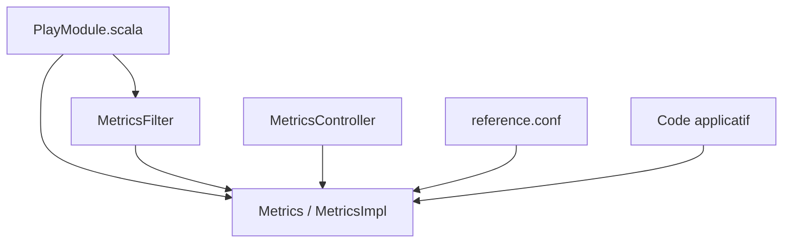

# kenshoo/metrics-play

> Module Scala qui branche la bibliothèque Metrics de Dropwizard dans une application Play 2.

## Le problème
Instrumenter une application Play avec des métriques JVM, HTTP et personnalisées demande du code de liaison.

## Ce que ça fait vraiment
Il fournit un registre de métriques par défaut, un filtre qui mesure durée, requêtes actives et codes de retour, et un contrôleur qui exporte les métriques en JSON. Le module est chargé par injection de dépendances Play. Les métriques JVM et Logback sont activées par défaut.

## Comment c'est branché


## Essayer
```scala
val appDependencies = Seq(
  "com.kenshoo" %% "metrics-play" % "2.7.3_0.8.2"
)
```
Puis dans application.conf : `play.modules.enabled+="com.kenshoo.play.metrics.PlayModule"`.

## Coût et pièges
Gratuit. La route d'export n'est pas protégée : l'application hôte doit la sécuriser. Le dernier push date de juillet 2025 et le README vise Play 2.7 et Scala 2.12.

## Ce que ce n'est pas
Pas un service autonome : il ne tourne que dans une application Play. Pas compatible avec une pile récente sans vérification. Le README évoque Play 2.8 seulement pour un correctif mineur. Il s'agit de Scala, non listé comme prérequis.

## Alternatives
Aucune alternative nommée dans le README.

## Pour toi
À ignorer : bibliothèque Scala pour Play 2.7, peu maintenue, sans usage dans une chaîne data, IA ou MLOps moderne.

