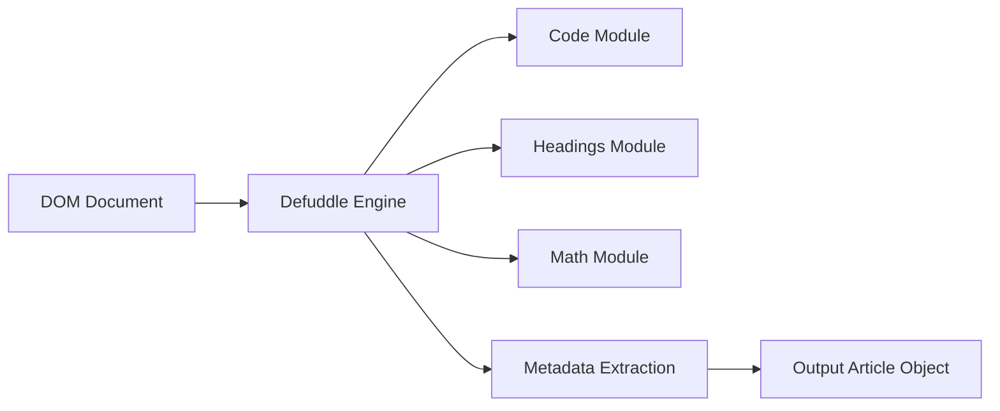

# kepano/defuddle

> Extracts the main content of a web page as clean HTML or Markdown, an alternative to Readability.

## The problem
Web pages are full of banners, menus and comments; to feed an LLM or a notebook, you need the useful text.

## What it actually does
Takes a URL or HTML, finds the main content, removes the clutter and returns HTML or Markdown, with metadata (title, author, schema.org, word count). Standardizes footnotes, math, code blocks and callouts. Usable in the browser, Node.js or CLI.

## How it is wired


## Trying it
```bash
npm install defuddle
npx defuddle parse https://example.com/article --markdown
```

## Cost and gotchas
Free. The README warns: "work in progress". For client-side rendered pages, it may query a third-party API (FxTwitter); can be disabled with `useAsync: false`.

## What it is not
Not a web crawler: it does not crawl. Not a JavaScript rendering engine: a page empty on the server side yields little content.

## Alternatives
Mozilla Readability is cited as the tool Defuddle can replace.

## For you
Worth adopting on trial: a simple building block for cleaning pages before RAG ingestion or summarization, in one npx command.
