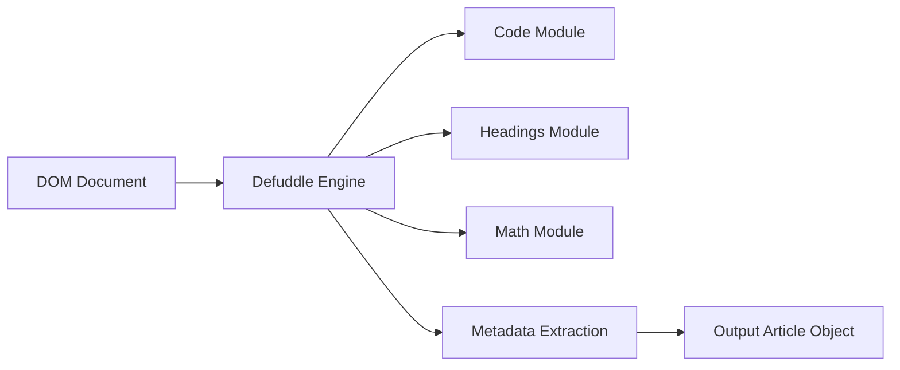

# kepano/defuddle

> Extrait le contenu principal d'une page web en HTML propre ou Markdown, alternative à Readability.

## Le problème
Les pages web sont pleines de bandeaux, menus et commentaires ; pour nourrir un LLM ou un carnet de notes, il faut le texte utile.

## Ce que ça fait vraiment
Prend une URL ou du HTML, repère le contenu principal, retire les éléments parasites et renvoie du HTML ou du Markdown, avec métadonnées (titre, auteur, schema.org, nombre de mots). Standardise notes, maths, blocs de code et encadrés. Utilisable en navigateur, Node.js ou CLI.

## Comment c'est branché


## Essayer
```bash
npm install defuddle
npx defuddle parse https://example.com/article --markdown
```

## Coût et pièges
Gratuit. Le README prévient : « travail en cours ». En cas de page rendue côté client, il peut interroger une API tierce (FxTwitter) ; désactivable avec `useAsync: false`.

## Ce que ce n'est pas
Pas un explorateur web : il ne crawle pas. Pas un moteur de rendu JavaScript : une page vide côté serveur donne peu de contenu.

## Alternatives
Mozilla Readability est cité comme l'outil que Defuddle peut remplacer.

## Pour toi
À adopter à l'essai : brique simple pour nettoyer des pages avant ingestion RAG ou résumé, en une commande npx.

