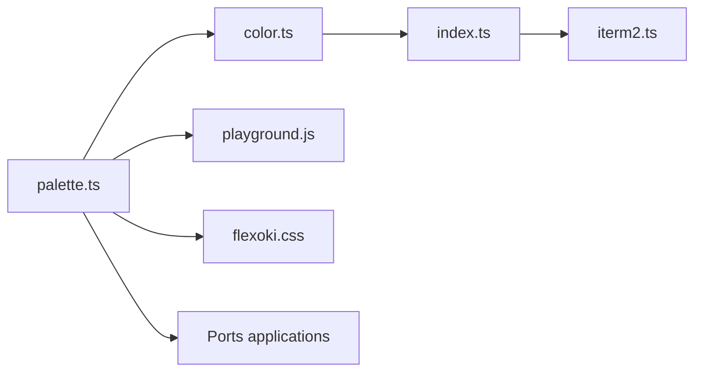

# kepano/flexoki

> Light/dark color palette inspired by ink and paper, with many ports.

## The problem
Editor and terminal themes are often too high-contrast or inconsistent across applications.

## What it actually does
Defines a palette (paper, bases 50 to 950, eight accent hues) in standard and extended versions, with hex and RGB values. A generator writes iTerm2 themes and a browser playground tests the palette. Community ports for dozens of applications (Neovim, VS Code, Alacritty, Tailwind, GIMP, Matplotlib, R).

## How it is wired

## Trying it
No command in the README: the online documentation explains how to apply the colors.

## Cost and gotchas
Free. Ports are maintained by third parties and of uneven quality. Last push on 2026-03-07.

## What it is not
Not a data visualization tool. Not an accessibility guarantee: the README claims no contrast testing.

## Alternatives
No alternative named in the README.

## For you
Watch: the Python/Matplotlib and R port gives a consistent palette for your charts and your editor, at no cost.
