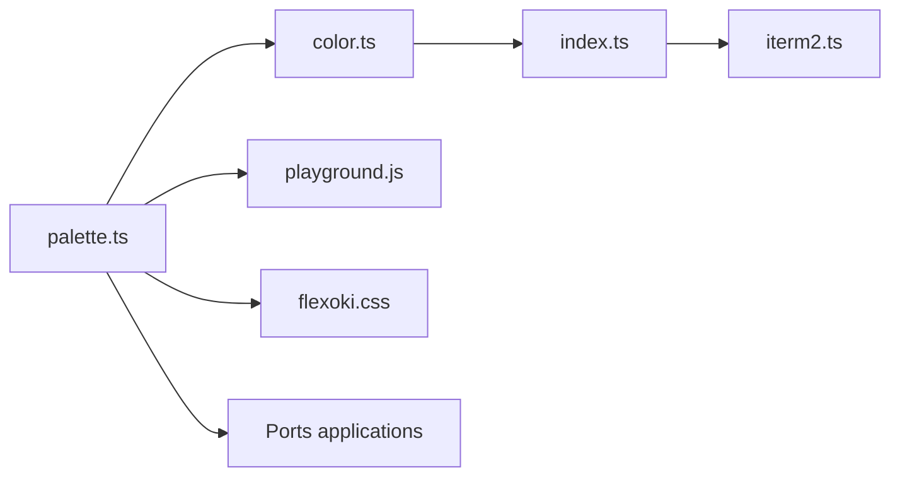

# kepano/flexoki

> Palette de couleurs claire/sombre inspirée de l'encre et du papier, avec de nombreux portages.

## Le problème
Les thèmes d'éditeur et de terminal sont souvent trop contrastés ou incohérents entre applications.

## Ce que ça fait vraiment
Définit une palette (papier, bases 50 à 950, huit teintes d'accent) en versions standard et étendue, avec valeurs hex et RGB. Un générateur écrit des thèmes iTerm2 et un terrain de jeu navigateur teste la palette. Portages communautaires pour des dizaines d'applications (Neovim, VS Code, Alacritty, Tailwind, GIMP, Matplotlib, R).

## Comment c'est branché

## Essayer
Aucune commande dans le README : la documentation en ligne explique comment appliquer les couleurs.

## Coût et pièges
Gratuit. Les portages sont maintenus par des tiers et de qualité inégale. Dernier push le 2026-03-07.

## Ce que ce n'est pas
Pas un outil de visualisation de données. Pas une garantie d'accessibilité : le README ne revendique aucun test de contraste.

## Alternatives
Aucune alternative nommée dans le README.

## Pour toi
Surveiller : le portage Python/Matplotlib et R donne une palette cohérente pour tes graphiques et ton éditeur, sans coût.

