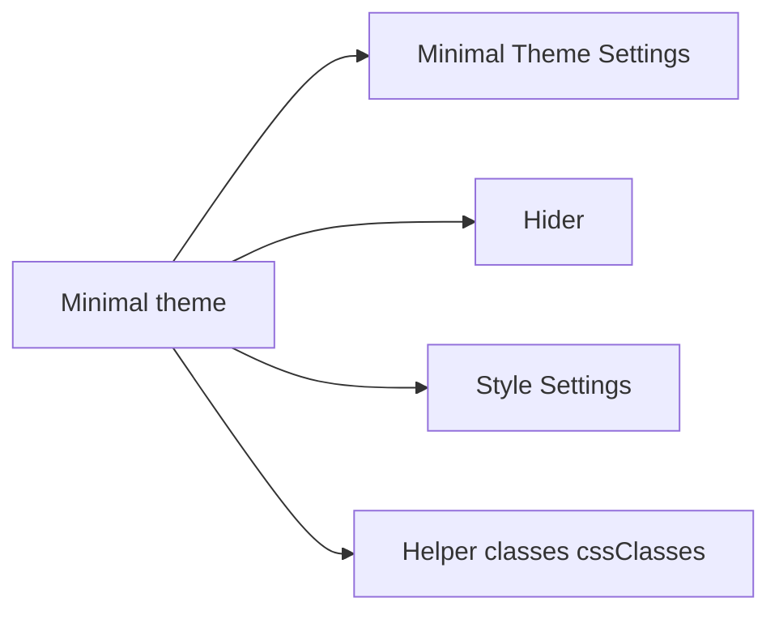

# kepano/obsidian-minimal

> Clean Obsidian theme for desktop, mobile and tablet, customizable through companion plugins.

## The problem
Obsidian's default interface is cluttered and hard to adjust for sober note-taking.

## What it actually does
CSS theme: contrast (including OLED black), color schemes (Dracula, Nord, Gruvbox…), line width, focus mode, image grids, Dataview cards, alternative checkboxes. Settings via the Minimal Theme Settings and Hider plugins.

## How it is wired


## Trying it
```
npm install
npm run dev    # watch and rebuild on changes
npm run build  # one-off build
```
For use: Settings > Appearance > Manage, search for "Minimal".

## Cost and gotchas
Free. May break on an Obsidian update or conflict with custom CSS; mostly tested on macOS according to the author.

## What it is not
Not a functional plugin: it only changes the appearance. Forks must keep the "Buy me a coffee" link.

## Alternatives
No alternative cited in the README.

## For you
Adopt if you take notes in Obsidian (your DevBrain vault): readability gain, zero risk.
