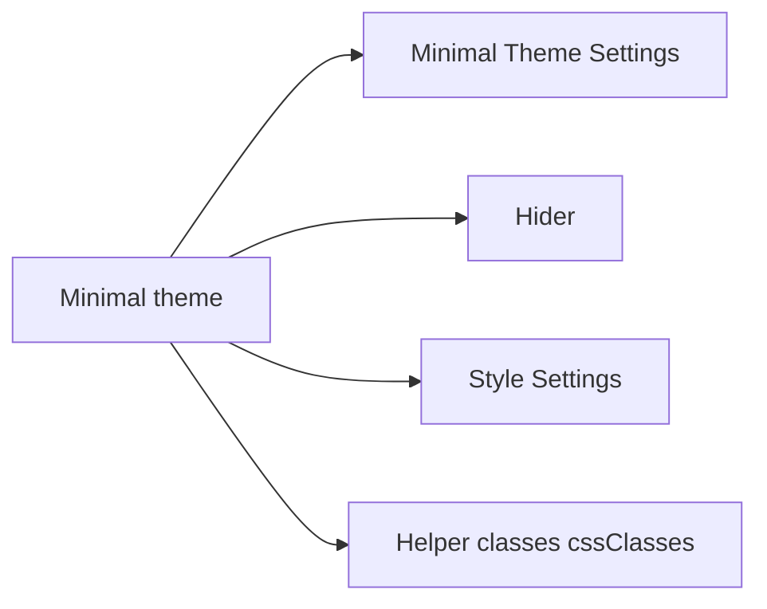

# kepano/obsidian-minimal

> Thème Obsidian épuré pour bureau, mobile et tablette, personnalisable par plugins compagnons.

## Le problème
L'interface d'Obsidian par défaut est chargée et peu ajustable pour une prise de notes sobre.

## Ce que ça fait vraiment
Thème CSS : contraste (dont noir OLED), schémas de couleur (Dracula, Nord, Gruvbox…), largeur de ligne, mode focus, grilles d'images, cartes Dataview, cases à cocher alternatives. Réglages via les plugins Minimal Theme Settings et Hider.

## Comment c'est branché


## Essayer
```
npm install
npm run dev    # watch and rebuild on changes
npm run build  # one-off build
```
Pour l'usage : Réglages > Apparence > Gérer, chercher « Minimal ».

## Coût et pièges
Gratuit. Peut casser à une mise à jour d'Obsidian ou entrer en conflit avec du CSS perso ; testé surtout sur macOS selon l'auteur.

## Ce que ce n'est pas
Pas un plugin fonctionnel : il ne change que l'apparence. Les forks doivent garder le lien « Buy me a coffee ».

## Alternatives
Aucune alternative citée dans le README.

## Pour toi
À adopter si tu prends des notes sous Obsidian (ton vault DevBrain) : gain de lisibilité, risque nul.

