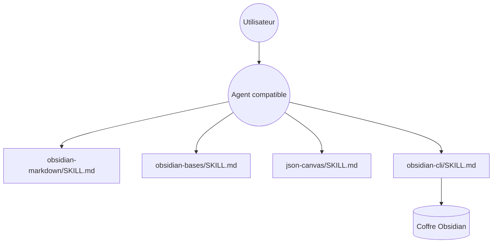

# kepano/obsidian-skills

> Six skills for agents to write and manage Obsidian vaults: Markdown, Basics, Canvas, CLI.

## The problem
The agents ignore the specific syntax of Obsidian (wiki links, callouts, `.base`, `.canvas`), and produce files that are unusable.

## What it actually does
Six skills: Markdown Obsidian, Basics, JSON Canvas, Obsidian CLI (reading/writing vault, plugin and theme development), Defuddle (web page to clean Markdown), and Knap (rendering models from JSON/CSV). Compatible with Claude Code, Codex, and OpenCode. No code snippets were provided.

## How it is wired


## Trying it
```bash
/plugin marketplace add kepano/obsidian-skills
/plugin install obsidian@obsidian-skills
npx skills add https://github.com/kepano/obsidian-skills
```

## Cost and gotchas
Free. The Obsidian CLI must be installed to use the corresponding skill. Skills can modify your inventory; be sure to save it.

## What it is not
Not an Obsidian plugin: these are instructions for agents. Nothing is mentioned about testing.

## Alternatives
No alternative is specified in the README file.

## For you
If you're using Obsidian to store your knowledge base, these practices will help prevent files from being corrupted by the agent: adopt them.
