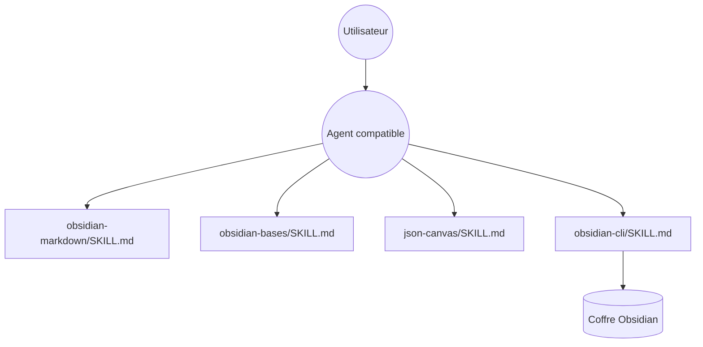

# kepano/obsidian-skills

> Six skills d'agent pour écrire et manipuler des coffres Obsidian : Markdown, Bases, Canvas, CLI.

## Le problème
Les agents ignorent la syntaxe propre à Obsidian (wikilinks, callouts, `.base`, `.canvas`) et produisent des fichiers inexploitables.

## Ce que ça fait vraiment
Six skills `SKILL.md` : Markdown Obsidian, Bases, JSON Canvas, Obsidian CLI (lecture/écriture du coffre, développement de plugins et thèmes), Defuddle (page web vers Markdown propre) et Knap (rendu de modèles depuis JSON/CSV). Compatibles Claude Code, Codex et OpenCode. Aucun extrait de code n'a été fourni.

## Comment c'est branché


## Essayer
```bash
/plugin marketplace add kepano/obsidian-skills
/plugin install obsidian@obsidian-skills
npx skills add https://github.com/kepano/obsidian-skills
```

## Coût et pièges
Gratuit. Le CLI Obsidian doit être installé pour le skill correspondant. Les skills peuvent modifier ton coffre : sauvegarde-le.

## Ce que ce n'est pas
Pas un plugin Obsidian : ce sont des instructions pour des agents. Rien n'est dit sur des tests.

## Alternatives
Aucune alternative nommée dans le README.

## Pour toi
Si tu tiens ta base de connaissances dans Obsidian, ces skills évitent des fichiers cassés par l'agent : adopte-les.

