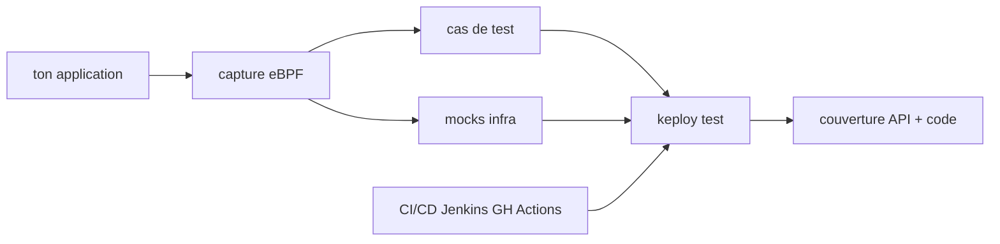

# keploy/keploy

> Generates API tests and mocks from real traffic, with no SDK and no code changes.

## The problem
Writing realistic integration tests requires simulating databases, queues and external APIs, one by one.
The result ages quickly, and nobody maintains it once the feature has shipped.

## What it actually does
Captures traffic at the network level via eBPF, then replays it as tests: no library to import.
Also records databases (Postgres, MySQL, MongoDB) and queues (Kafka, RabbitMQ), not just HTTP.
Computes both statement and branch coverage, and API schema coverage.
Uses the recordings and a Swagger/OpenAPI schema to generate additional edge cases.

## How it is wired


## Trying it
```bash
curl --silent -O -L https://keploy.io/install.sh && source install.sh
keploy record -c "python main.py"
keploy test -c "CMD_TO_RUN_APP" --delay 10
```

## Cost and gotchas
eBPF implies a Linux kernel and network interception privileges: to be validated before installing.
The README states that some dependencies on non-open protocols are not supported on the enterprise side.

## What it is not
Not a replacement for unit tests: it replays real user journeys, it does not test an isolated function.
Not entirely open in scope: part of it belongs to an enterprise edition.
Not a load-testing tool: it makes recorded scenarios deterministic, it does not multiply them.

## Alternatives
None named in the README.

## For you
Interesting for freezing the behavior of a scoring API before a refactor; test outside production first.
