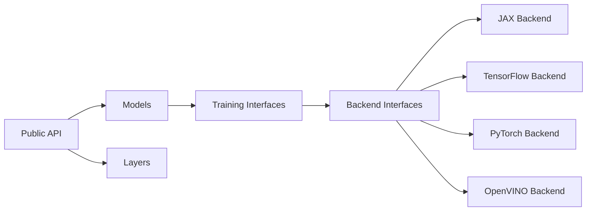

# keras-team/keras

> High-level deep learning framework that runs on JAX, TensorFlow, PyTorch or OpenVINO.

## The problem
Choosing a deep learning framework locks in your code: moving from TensorFlow to JAX or PyTorch forces you to rewrite everything.

## What it actually does
A single API (models, layers, trainers, losses, metrics, callbacks) sits on an abstraction layer (`keras/src/backend`, `keras/src/ops`) implemented by each backend. The backend is chosen via `KERAS_BACKEND` or `~/.keras/keras.json`, before import.
A Keras model can be trained in a native TF, JAX or PyTorch loop, or dropped into a PyTorch `Module`. It accepts `tf.data` as well as `DataLoader`. Replaces `tf.keras` with no change when using the TensorFlow backend.

## How it is wired


## Trying it
```bash
pip install keras --upgrade
export KERAS_BACKEND="jax"
pip install -r requirements.txt
python pip_build.py --install
```

## Cost and gotchas
Free, Apache-2.0. The backend (tensorflow, jax or torch) is installed separately; Windows via WSL2. The backend can no longer be changed after import.

## What it is not
OpenVINO is for inference only (`model.predict()`). Custom components (layers, `train_step()`) need conversion to become multi-backend. The announced speed gains (20 to 350%) come from a benchmark by the publisher.

## Alternatives
- tf-keras — Keras 2, for old `tf.keras` code you do not want to migrate.

## For you
Adopt it if you want backend-independent model code, especially to try JAX.
