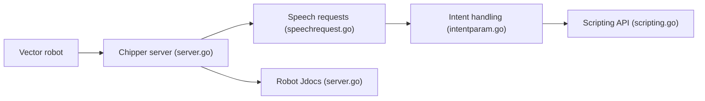

# kercre123/wire-pod

> Server that makes the voice commands of the Anki/DDL Vector robot work without a subscription.

## The problem
The Vector robot loses its voice commands without the official cloud service.

## What it actually does
Replaces the voice server: the robot sends speech, a chosen recognizer feeds intent handling and responses; it also handles Jdocs, tokens, configuration, localization and a scripting API. The repository also contains a cloud runtime and an RPC gateway. Installation and details are deferred to the wiki.

## How it is wired


## Trying it
```bash
# Aucune commande dans le README : l'installation est décrite dans le wiki.
```

## Cost and gotchas
Free; a Vector robot is required. The installation procedure is outside the README.

## What it is not
Not a general-purpose speech recognition application: it only serves Vector. Very short README (credits, donation).

## Alternatives
No alternative named in the README.

## For you
Ignore: only useful to owners of a Vector robot, with no transfer value for a data/AI profile.
