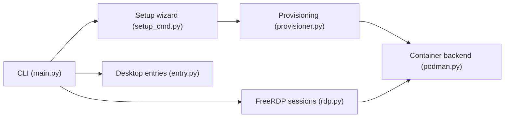

# kernalix7/winpodx

> Runs Windows applications as native Linux windows via FreeRDP RemoteApp on a Windows container.

## The problem
Using Word or other Windows apps on Linux without dual boot or a full-screen Windows desktop.

## What it actually does
- Provisions Windows 11 in Podman or Docker (dockur/windows), discovers the apps and creates desktop entries.
- Each app opens in its own window; clipboard, audio, printers and home folder are shared.
- Pauses the VM when idle; GUI, tray, USB/PCI passthrough.
- "Beta" status, v0.11.0; Python 3.10 minimum.

## How it is wired


## Trying it
```bash
curl -fsSL https://raw.githubusercontent.com/kernalix7/winpodx/main/install.sh | bash
winpodx setup
winpodx app run word
winpodx gui
```

## Cost and gotchas
Hardware virtualization (VT-x/AMD-V, KVM), 8 GB of RAM (12 recommended), 64 GB Windows disk plus ISO. A Windows license remains at your expense. Installation via `curl | bash`.

## What it is not
Not Wine emulation: a real Windows VM runs in the background. Not for heavy GPU use.

## Alternatives
The README cites winapps, LinOffice, winboat and Wine (COMPARISON.md file).

## For you
Worth watching: handy if you need to open Windows tools from a Linux machine, but resource-hungry and still in beta.
