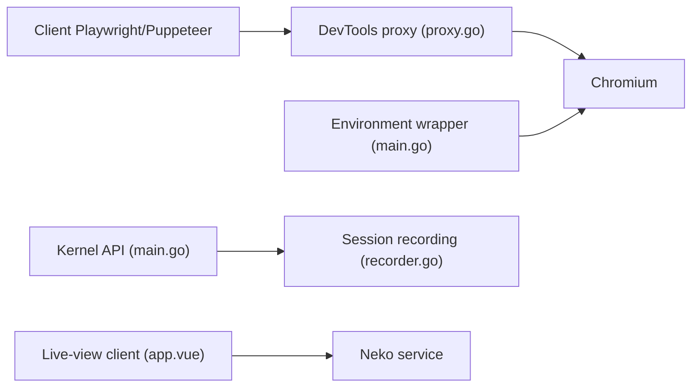

# kernel/kernel-images

> Sandboxed Chrome images, with live view and replay, for web agents and browser automation.

## The problem
Agents that drive a browser need an isolated, observable and replayable Chrome that Playwright or Puppeteer can reach remotely.

## What it actually does
Runs Chromium with a UI in Docker or on a Unikraft unikernel. Exposes the CDP port 9222, a live view (noVNC or WebRTC) and H.264 video recording through a local API. The unikernel adds automatic standby and state restore.

## How it is wired


## Trying it
```bash
cd images/chromium-headful
IMAGE=kernel-docker ./build-docker.sh
IMAGE=kernel-docker ENABLE_WEBRTC=true ./run-docker.sh
```

## Cost and gotchas
Free locally; the unikernel requires at least 8 GB of memory and a Unikraft account. The live-view URL is public: do not put sensitive content in it. WebRTC audio does not work.

## What it is not
Not an agent framework or an automation client: it is the browser and its wrapper. The repository feeds their hosted service.

## Alternatives
No alternative named in the README.

## For you
Watch: a practical building block for giving an agent a browser, but only if you really need one; the hosted service remains the commercial option.
