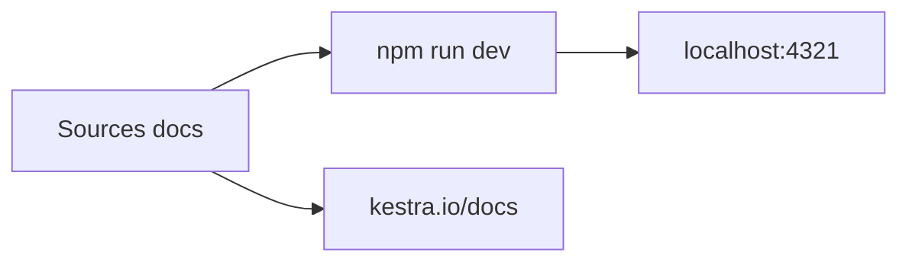

# kestra-io/docs

> Sources of the official documentation of Kestra, a declarative, event-driven workflow orchestrator.

## The problem
Kestra's documentation has to be maintained, reviewed and viewed locally before publication.

## What it actually does
Contains the documentation site published at kestra.io/docs, which runs locally with Node and NPM on port 4321. Kestra is described as an open-source orchestration platform for workflows written as code. The README does not describe Kestra in more detail.

## How it is wired
Simplified diagram based on the sheet, no diagram provided.


## Trying it
```bash
npm install
npm run dev
```

## Cost and gotchas
Node and NPM are enough. 153 open issues; new releases every month.

## What it is not
Not Kestra itself: the engine lives in another repository.

## Alternatives
No alternative named in the README.

## For you
Worth watching: only useful for reading or fixing Kestra's documentation, an orchestrator relevant to your MLOps profile.
