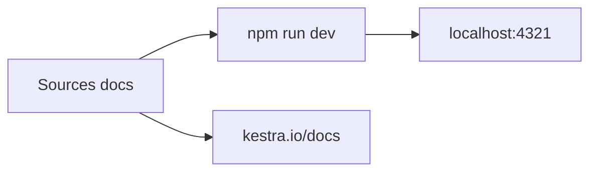

# kestra-io/docs

> Sources de la documentation officielle de Kestra, orchestrateur de workflows déclaratifs et événementiels.

## Le problème
La documentation de Kestra doit être maintenue, relue et consultée localement avant publication.

## Ce que ça fait vraiment
Contient le site de documentation publié sur kestra.io/docs, qui se lance en local avec Node et NPM sur le port 4321. Kestra est décrit comme une plateforme d'orchestration open source pour des workflows écrits en code. Le README ne décrit pas Kestra plus en détail.

## Comment c'est branché
Schéma simplifié d'après la fiche, sans diagramme fourni.


## Essayer
```bash
npm install
npm run dev
```

## Coût et pièges
Node et NPM suffisent. 153 issues ouvertes ; nouvelles versions chaque mois.

## Ce que ce n'est pas
Pas Kestra lui-même : le moteur est dans un autre dépôt.

## Alternatives
Aucune alternative nommée dans le README.

## Pour toi
À surveiller : ne te sert que pour lire ou corriger la documentation de Kestra, un orchestrateur utile à ton profil MLOps.

