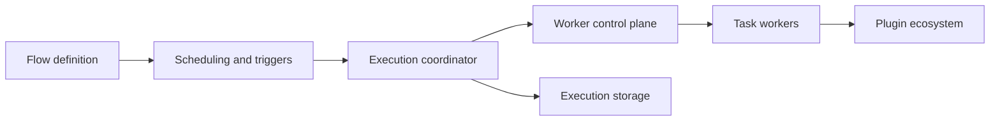

# kestra-io/kestra

> Event-driven orchestration platform, YAML workflows, for data, AI and infrastructure pipelines.

## The problem
Scheduling and linking scripts, SQL queries, Spark jobs and LLM calls, with retry, monitoring and event-based triggering, without coding a homegrown orchestrator.

## What it actually does
Flows are described in YAML (no-code editor, AI copilot, topology editor); each task comes from a plugin (Python, Node, R, Go, Shell, SQL, HTTP, cloud, LLM). Scheduled or event-based triggers (Kafka, SQS, Pub/Sub…). Version 2.0 adds AI agents and RAG in flows, an MCP server, cloud VM executors and a gRPC controller between server and workers. Git integration, Terraform and the `kestractl` CLI. The Enterprise edition adds RBAC, promotion between instances, etc.

## How it is wired


## Trying it
```bash
docker run --pull=always --rm -it -p 8080:8080 --user=root \
  --name kestra \
  -v kestra_data:/app/storage \
  -v kestra_db:/app/data \
  -v /var/run/docker.sock:/var/run/docker.sock \
  -v /tmp:/tmp \
  -e KESTRA_PLUGINS_AUTO_INSTALL_ENABLED=true \
  kestra/kestra:latest-slim server local
```

## Cost and gotchas
Open edition is free; Enterprise is paid. The command mounts the Docker socket and runs as root: keep it to a test machine. Plugins are downloaded from Maven Central on first use. LLM calls are billed to your API key. The 2.0 migration has breaking changes (`Loop`, `when`).

## What it is not
Not a "workflow as code" orchestration tool in Python: control is declarative in YAML. Enterprise features (RBAC, Cases, Policies) are not in the open edition.

## Alternatives
No alternative cited in the README.

## For you
Adopt it to orchestrate data pipelines and AI workflows from an interface with versioned YAML; it can replace a fragile cron or a heavy Airflow.
