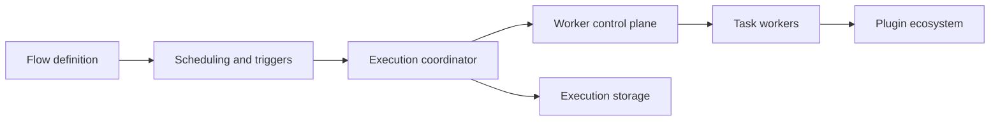

# kestra-io/kestra

> Plateforme d'orchestration pilotée par événements, workflows en YAML, pour pipelines de données, d'IA et d'infrastructure.

## Le problème
Planifier et relier scripts, requêtes SQL, jobs Spark et appels de LLM, avec reprise, suivi et déclenchement sur événements, sans coder un orchestrateur maison.

## Ce que ça fait vraiment
Les flux sont décrits en YAML (éditeur sans code, copilote IA, éditeur de topologie) ; chaque tâche vient d'un plugin (Python, Node, R, Go, Shell, SQL, HTTP, cloud, LLM). Déclencheurs planifiés ou sur événements (Kafka, SQS, Pub/Sub…). La 2.0 ajoute agents IA et RAG dans les flux, un serveur MCP, des exécuteurs de VM cloud et un contrôleur gRPC entre serveur et workers. Intégration Git, Terraform et CLI `kestractl`. L'édition Enterprise ajoute RBAC, promotion entre instances, etc.

## Comment c'est branché


## Essayer
```bash
docker run --pull=always --rm -it -p 8080:8080 --user=root \
  --name kestra \
  -v kestra_data:/app/storage \
  -v kestra_db:/app/data \
  -v /var/run/docker.sock:/var/run/docker.sock \
  -v /tmp:/tmp \
  -e KESTRA_PLUGINS_AUTO_INSTALL_ENABLED=true \
  kestra/kestra:latest-slim server local
```

## Coût et pièges
Édition ouverte gratuite ; Enterprise payante. La commande monte le socket Docker et tourne en root : à réserver à un poste de test. Les plugins sont téléchargés depuis Maven Central au premier usage. Les appels de LLM sont à la charge de ta clé d'API. Migration 2.0 avec changements incompatibles (`Loop`, `when`).

## Ce que ce n'est pas
Pas un outil d'orchestration « workflow as code » en Python : le contrôle est déclaratif en YAML. Les fonctions Enterprise (RBAC, Cases, Policies) ne sont pas dans l'édition ouverte.

## Alternatives
Aucune alternative citée dans le README.

## Pour toi
À adopter pour orchestrer pipelines de données et workflows d'IA depuis une interface avec du YAML versionné ; il peut remplacer un cron fragile ou un Airflow lourd.

