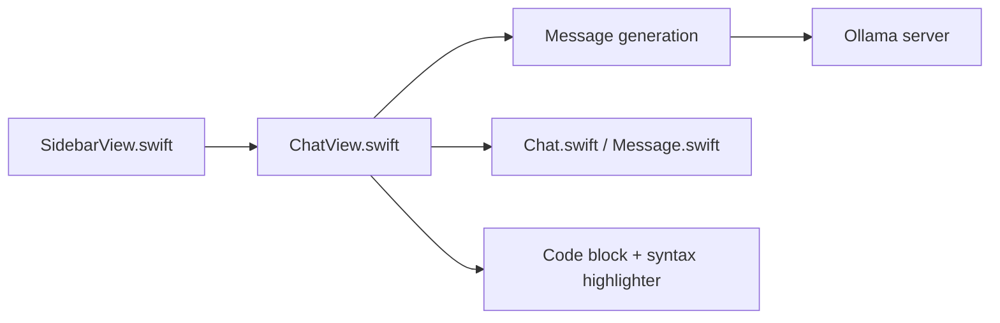

# kevinhermawan/Ollamac

> Native macOS chat client for a local Ollama server, with syntax highlighting.

## The problem
Talking to your Ollama models without going through the terminal.

## What it actually does
SwiftUI app that connects to a configurable Ollama host, lists installed models, stores chats and messages in SwiftData, and displays replies in Markdown with code highlighting. System prompt and preferences per conversation.

## How it is wired


## Trying it
```bash
brew install --cask ollamac
```

## Cost and gotchas
Free. Requires macOS 14 and Ollama installed with at least one model. Last push in March 2025; license not identified by GitHub. Commercial apps with the same name exist: only download from the official repository.

## What it is not
Not a model server nor cross-platform: macOS only.

## Alternatives
No alternative named in the README.

## For you
Ignore unless you need a minimal Mac client: little maintained since March 2025, unclear license.
