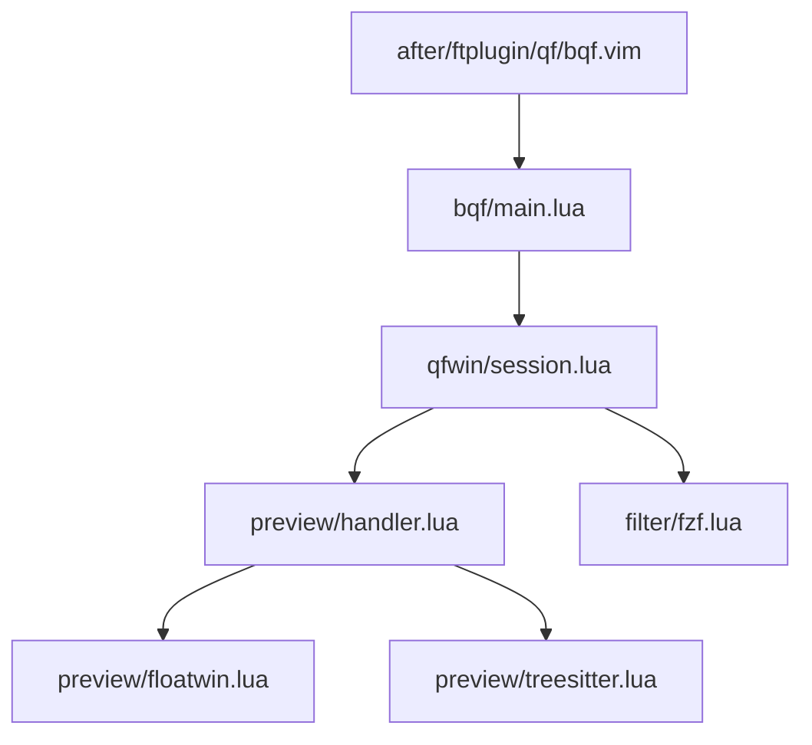

# kevinhwang91/nvim-bqf

> Neovim plugin that improves the quickfix window with a floating preview and an fzf filter.

## The problem
Neovim's quickfix window is austere: no lasting preview, no fuzzy search, constant back-and-forth.

## What it actually does
A "magic" window that keeps its position, a preview in a floating window with treesitter highlighting, item marking through signs, creation of new filtered lists, an fzf mode (ctrl-t/x/v to open in a tab or split) and mouse actions. It combines with external grep and coc.nvim.

## How it is wired


## Trying it
```bash
:vimgrep /\w\+/j % | copen
```
```lua
use {'kevinhwang91/nvim-bqf', ft = 'qf'}
```

## Cost and gotchas
Neovim 0.6.1 or later. fzf and nvim-treesitter are optional but recommended. Tests are still on the to-do list.

## What it is not
Not a code search engine; it reworks the display of an existing list.

## Alternatives
No alternative named in the README.

## For you
Ignore: Neovim editing comfort, unrelated to data/AI; only worth testing if you live in quickfix.
