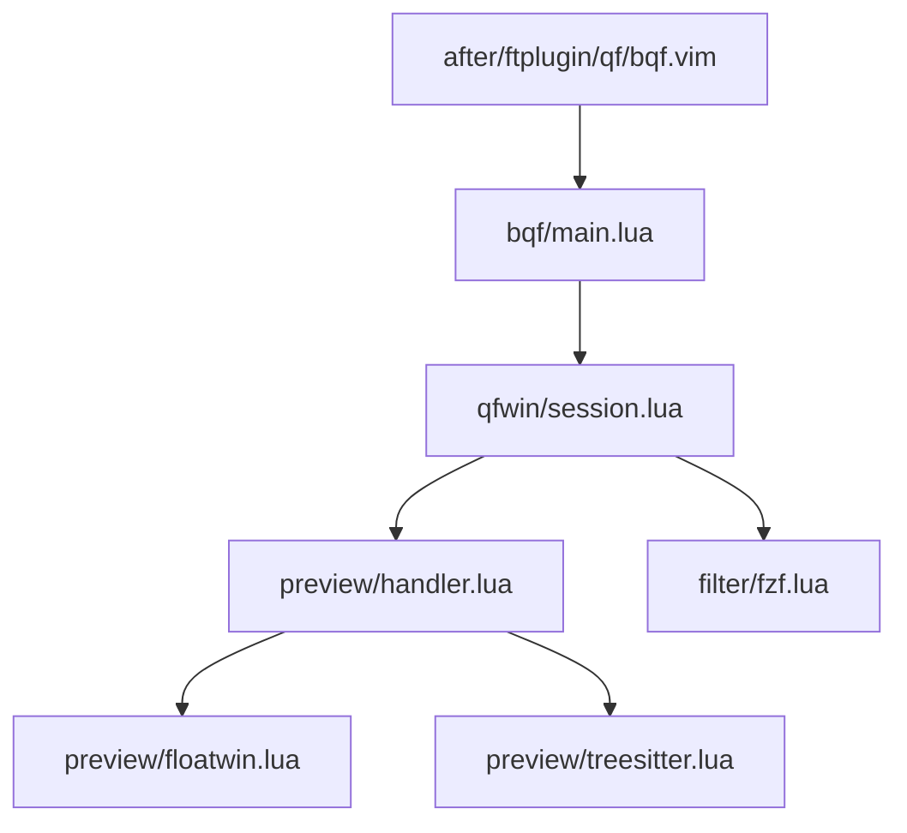

# kevinhwang91/nvim-bqf

> Plugin Neovim qui améliore la fenêtre quickfix avec aperçu flottant et filtre fzf.

## Le problème
La fenêtre quickfix de Neovim est austère : pas d'aperçu durable, pas de recherche floue, aller-retours constants.

## Ce que ça fait vraiment
Fenêtre « magique » qui garde la position, aperçu en fenêtre flottante avec coloration treesitter, marquage d'éléments par signes, création de nouvelles listes filtrées, mode fzf (ctrl-t/x/v pour ouvrir en onglet ou split) et actions souris. Se combine avec grep externe et coc.nvim.

## Comment c'est branché


## Essayer
```bash
:vimgrep /\w\+/j % | copen
```
```lua
use {'kevinhwang91/nvim-bqf', ft = 'qf'}
```

## Coût et pièges
Neovim 0.6.1 ou plus. fzf et nvim-treesitter sont optionnels mais recommandés. Les tests figurent encore dans les choses à faire.

## Ce que ce n'est pas
Pas un moteur de recherche de code ; il retravaille l'affichage d'une liste existante.

## Alternatives
Aucune alternative nommée dans le README.

## Pour toi
Ignorer : confort d'édition Neovim, sans lien avec data/IA ; à tester seulement si tu vis dans quickfix.

