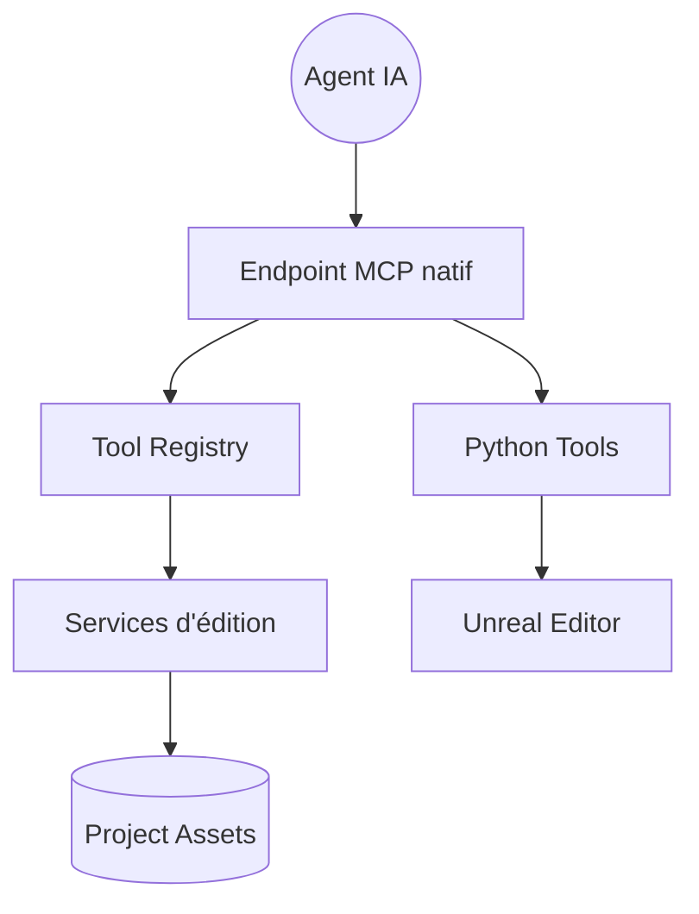

# kevinpbuckley/VibeUE

> MCP extension for Unreal Engine 5.8+ that lets an AI agent drive the editor: terrain, animation, profiling.

## The problem
Unreal 5.8's native AI tools cover neither profiling, nor audio, nor animation in depth.

## What it actually does
Adds itself to Unreal's MCP server and registers services (Blueprints, landscape, Niagara, UMG, behavior trees, performance) accessible to agents. `execute_python_code` bundles a piece of work into a single call. A performance service measures frame time and captures Insights traces. About 36 skill packs are provided.

## How it is wired
Diagram based on the one extracted from the code.


## Trying it
```bash
cd /path/to/YourProject/Plugins
git clone https://github.com/kevinpbuckley/VibeUE.git
Plugins/VibeUE/BuildAndLaunchGame.sh --engine /path/to/UE5
```
Then in the editor console: `ModelContextProtocol.GenerateClientConfig ClaudeCode`.

## Cost and gotchas
Unreal Engine 5.8+ required, with the experimental MCP plugins enabled first. A free API key only unlocks real terrain. The MCP server is limited to the local machine, with no authentication.

## What it is not
Not a separate server nor a chat inside the editor. It does not replace Unreal's general tools.

## Alternatives
Not documented in the README.

## For you
Worth watching: relevant only if you have an agent drive Unreal; it shows a good example of MCP with Python, but remains tied to an engine in experimental version.
