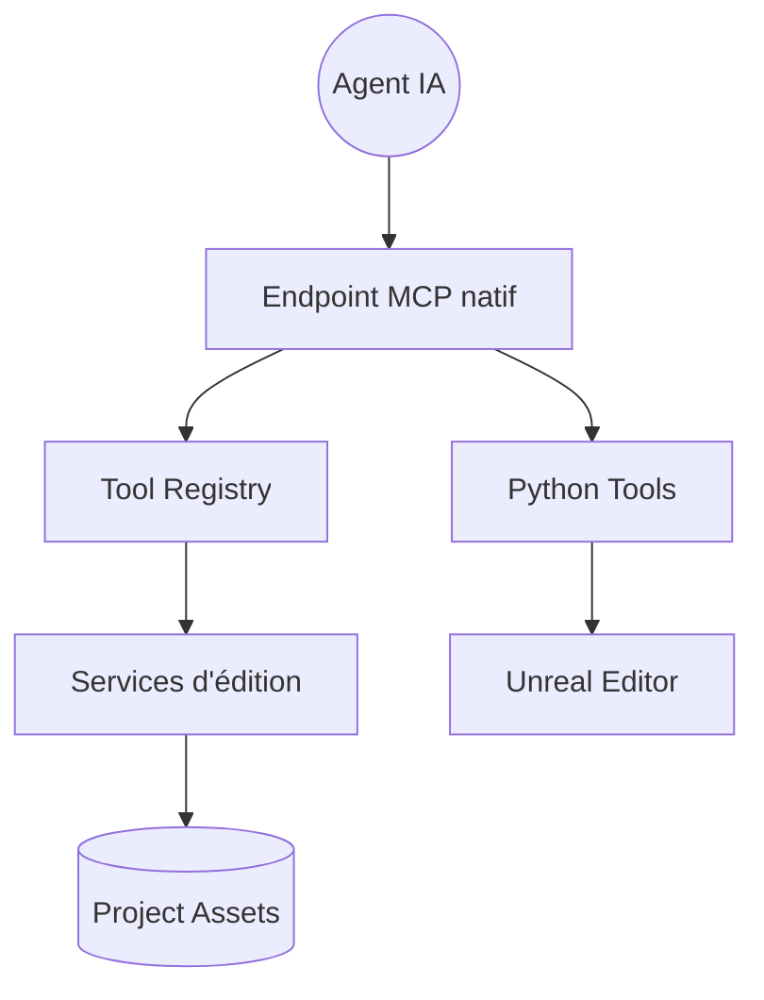

# kevinpbuckley/VibeUE

> Extension MCP pour Unreal Engine 5.8+ qui laisse un agent IA piloter l'éditeur : terrain, animation, profilage.

## Le problème
Les outils IA natifs d'Unreal 5.8 ne couvrent ni le profilage, ni l'audio, ni l'animation en profondeur.

## Ce que ça fait vraiment
S'ajoute au serveur MCP d'Unreal et enregistre des services (Blueprints, paysage, Niagara, UMG, arbres de comportement, performance) accessibles aux agents. `execute_python_code` regroupe un travail en un seul appel. Un service de performance mesure le temps d'image et capture des traces Insights. Environ 36 packs de compétences sont fournis.

## Comment c'est branché
Schéma d'après le diagramme tiré du code.


## Essayer
```bash
cd /path/to/YourProject/Plugins
git clone https://github.com/kevinpbuckley/VibeUE.git
Plugins/VibeUE/BuildAndLaunchGame.sh --engine /path/to/UE5
```
Puis dans la console de l'éditeur : `ModelContextProtocol.GenerateClientConfig ClaudeCode`.

## Coût et pièges
Unreal Engine 5.8+ requis, avec les plugins MCP expérimentaux activés d'abord. Une clé d'API gratuite débloque seulement le terrain réel. Le serveur MCP est limité à la machine locale, sans authentification.

## Ce que ce n'est pas
Ce n'est pas un serveur séparé ni un chat dans l'éditeur. Il ne remplace pas les outils généraux d'Unreal.

## Alternatives
Non documenté dans le README.

## Pour toi
À surveiller : pertinent seulement si tu fais piloter Unreal par un agent ; il montre un bon exemple de MCP avec Python, mais reste lié à un moteur en version expérimentale.

