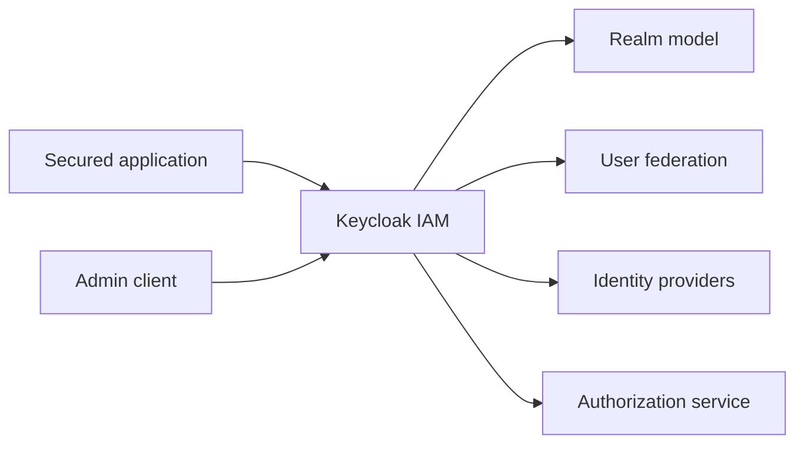

# keycloak/keycloak

> Open-source identity and access server: authentication, user federation, fine-grained authorization.

## The problem
Adding authentication and authorization to applications without managing accounts and passwords yourself.

## What it actually does
Manages users and realms, federation (LDAP), identity providers, strong authentication, and policy-based authorization. Java and Node.js clients, SAML adapters, admin client. The README says little about internals; the detailed wiring is not documented here.

## How it is wired


## Trying it
```bash
bin/kc.[sh|bat] start-dev
docker run quay.io/keycloak/keycloak start-dev
```

## Cost and gotchas
Free. The `start-dev` mode is for development; going to production requires the installation and security guides. Operations (database, high availability) are on you.

## What it is not
Not a simple library component: it is a server to operate. It has over 3,000 open issues.

## Alternatives
None named in the README.

## For you
Worth watching: a reference for securing APIs and MLOps tools (MLflow, Grafana…) with SSO, to study when the need for authentication arises.
