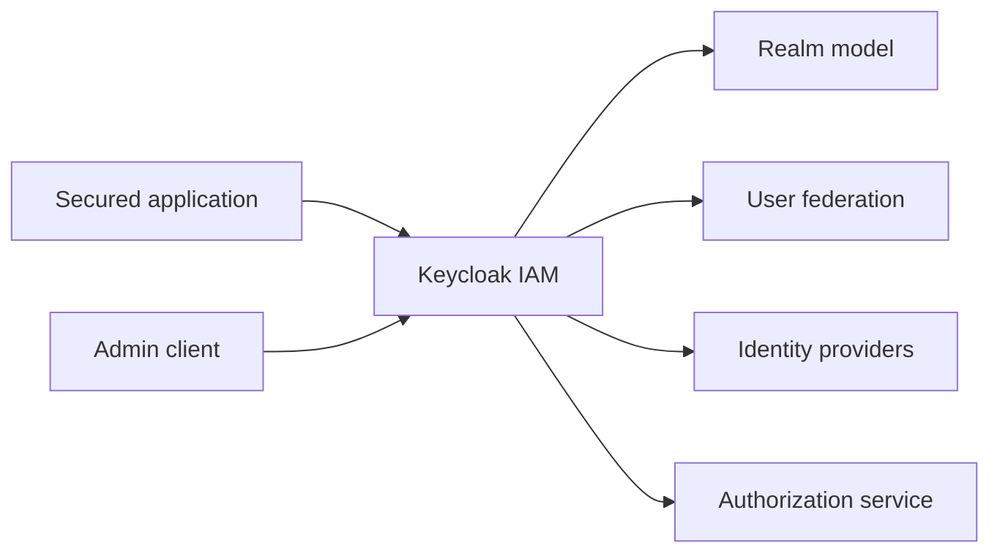

# keycloak/keycloak

> Serveur d'identité et d'accès open source : authentification, fédération d'utilisateurs, autorisation fine.

## Le problème
Ajouter authentification et autorisation à des applications sans gérer soi-même comptes et mots de passe.

## Ce que ça fait vraiment
Gère utilisateurs et royaumes, fédération (LDAP), fournisseurs d'identité, authentification forte, et autorisation par politiques. Clients Java et Node.js, adaptateurs SAML, client d'administration. Le README parle peu des internes ; le câblage détaillé n'est pas documenté ici.

## Comment c'est branché


## Essayer
```bash
bin/kc.[sh|bat] start-dev
docker run quay.io/keycloak/keycloak start-dev
```

## Coût et pièges
Gratuit. Le mode `start-dev` est pour le développement ; la mise en production demande les guides d'installation et de sécurité. Exploitation (base, haute disponibilité) à ta charge.

## Ce que ce n'est pas
Pas un simple composant de bibliothèque : c'est un serveur à exploiter. Il compte plus de 3 000 issues ouvertes.

## Alternatives
Aucune alternative nommée dans le README.

## Pour toi
À surveiller : référence pour sécuriser les API et outils MLOps (MLflow, Grafana…) en SSO, à étudier quand le besoin d'authentification se présente.

