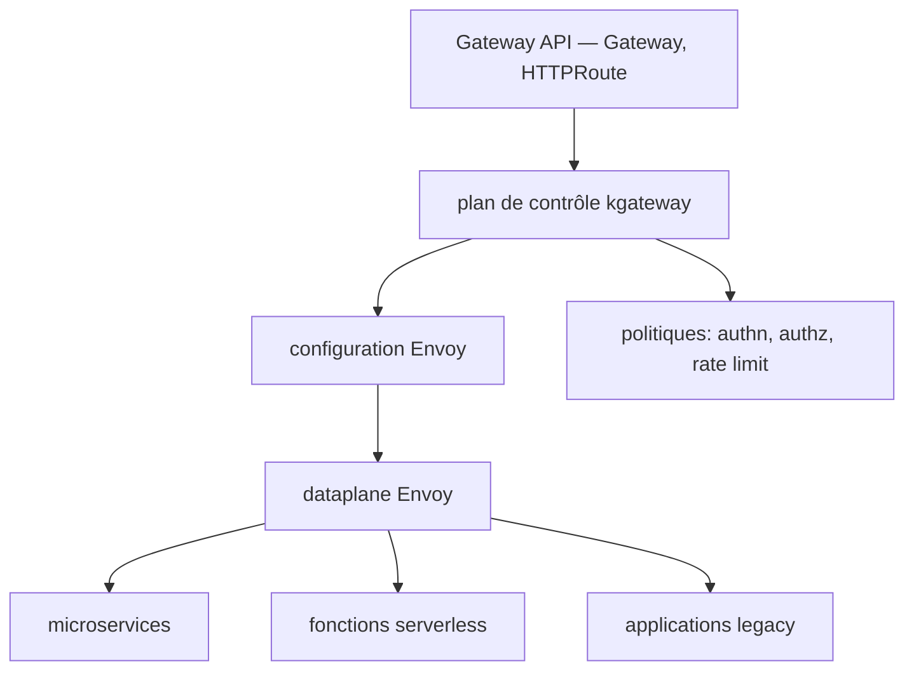

# kgateway-dev/kgateway

> Envoy control plane implementing the Kubernetes Gateway API to expose services.

## The problem
Exposing APIs on Kubernetes while enforcing authentication, authorization and rate limiting is usually done in three different places.
Migrating a legacy application to microservices requires routing to both at the same time.

## What it actually does
It implements the Kubernetes Gateway API on top of Envoy, from the micro-gateway between services to the centralized gateway handling billions of calls.
It applies policies — authentication, authorization, rate limiting — in the same place as the route description.
It routes to heterogeneous backends: microservices, serverless functions or legacy applications, which enables a gradual migration.
Route delegation and composable policies give several teams a way to express their APIs in a single cluster.

## How it is wired


## Trying it
No installation command is present in the README: it points to the project documentation and to `devel/contributing/releasing.md` for the release process.

```bash
# aucune commande documentée dans le README — voir la documentation kgateway
```

## Cost and gotchas
Free, but you need a Kubernetes cluster and must accept Envoy as the dataplane.
Beware of the scope change: since 2.3.0, the agentgateway control plane has been moved to the agentgateway repository — the AI and agentic features are no longer here.

## What it is not
It is no longer an AI gateway: the README says so explicitly, kgateway is refocusing on its role as an Envoy API Gateway.
Nor is it a new project: it is Gloo, launched in 2018 by Solo.io, renamed — the headline superlatives come from the project, not from a measurement.

## Alternatives
- agentgateway: cited as the repository that now carries the control plane for AI and agentic use cases.
- Gloo: the former name, with a documented migration plan.

## For you
Not directly relevant to data/AI since agentgateway left; that latter repository is the one to follow.
