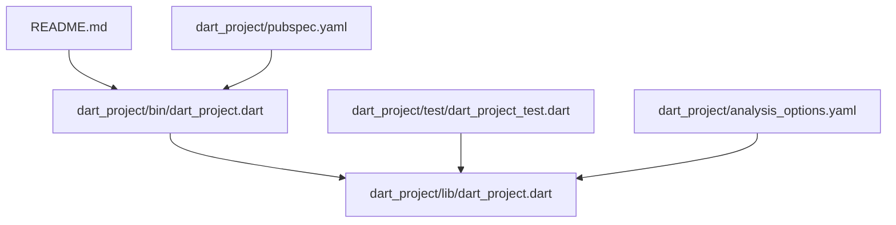

# khanifzyen/dart-basics

> Introductory Dart course in Indonesian for mobile programming students.

## The problem
Students learning Flutter must first master the basics of the Dart language.

## What it actually does
Course module: types, variables, operators, user input, conditions, loops, with exercises. Students clone, work on a `dev` branch and submit their repository via an issue. A small example Dart project accompanies the course.

## How it is wired


## Trying it
```bash
git clone https://github.com/namauser/dart-basics.git
git checkout -b dev
git add .
git commit -m "perulangan for in"
git push -u origin dev
```

## Cost and gotchas
Text in Indonesian, written for a 2023 course; some code snippets contain errors (typographic quotes, while loop without increment).

## What it is not
Not an official Dart reference nor a complete course: only the basics.

## Alternatives
Official dart.dev documentation and DartPad, cited in the README.

## For you
Ignore: beginner course in Indonesian, unrelated to data/AI.
