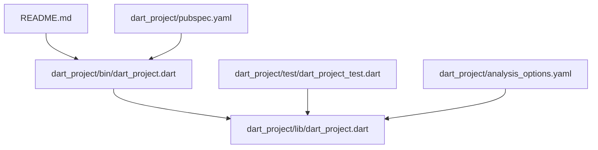

# khanifzyen/dart-basics

> Cours d'introduction à Dart en indonésien pour étudiants de programmation mobile.

## Le problème
Des étudiants qui apprennent Flutter doivent d'abord maîtriser les bases du langage Dart.

## Ce que ça fait vraiment
Module de cours : types, variables, opérateurs, saisie utilisateur, conditions, boucles, avec des exercices. Les étudiants clonent, travaillent sur une branche `dev` et soumettent leur dépôt via une issue. Un petit projet Dart d'exemple accompagne le cours.

## Comment c'est branché


## Essayer
```bash
git clone https://github.com/namauser/dart-basics.git
git checkout -b dev
git add .
git commit -m "perulangan for in"
git push -u origin dev
```

## Coût et pièges
Texte en indonésien, rédigé pour un cours de 2023 ; certains extraits de code contiennent des erreurs (guillemets typographiques, boucle while sans incrément).

## Ce que ce n'est pas
Pas une référence officielle de Dart ni un cours complet : seulement les bases.

## Alternatives
Documentation officielle dart.dev et DartPad, citées dans le README.

## Pour toi
À ignorer : cours de débutant en indonésien, sans lien avec data/IA.

