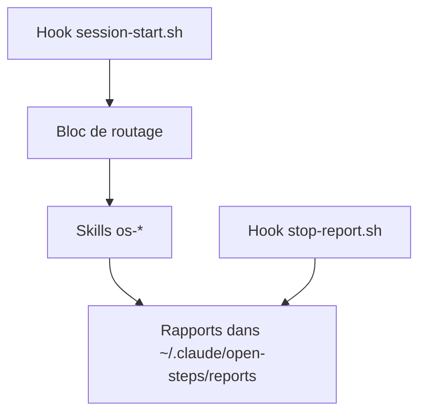

# kharmanskyi/open-steps

> Eight agent skills that make Claude Code, Codex, Cursor and Gemini CLI speak in plain language.

## The problem
Agents report their work in hashes and jargon, and a non-engineer cannot tell whether the work is done.

## What it actually does
Eight `os-*` skills: a one-page report with a verdict (`os-done-or-not`), step-by-step walkthroughs, simple questions, premortem, next task, checking another session's work, rephrasing and `BIG-PICTURE.md`. Two hooks open the session with the routing table and ask for a report at the end of the work. It merges a pull request on its own when checks are green and it is approved.

## How it is wired
Simplified diagram based on the fiche, no diagram provided.



## Trying it
```bash
git clone https://github.com/kharmanskyi/open-steps.git
claude plugin marketplace add ./open-steps && claude plugin install open-steps@open-steps
grep -q 'os-done-or-not' ~/.claude/CLAUDE.md 2>/dev/null || cat open-steps/docs/routing-block.md >> ~/.claude/CLAUDE.md
```

## Cost and gotchas
Free. The routing block is added to your `CLAUDE.md`. It can run `gh pr merge` without asking on Claude Code: write the note "merge on command only" to avoid it. The hooks add text to the context.

## What it is not
It is not a tool that does the work: it mostly changes what the agent tells you. The author's measurements (three trials per sentence) are a quick test, not a benchmark.

## Alternatives
No alternative named in the README.

## For you
Worth watching: the idea of short, verifiable reports is good for your agent sessions, but the automatic merge calls for caution.
