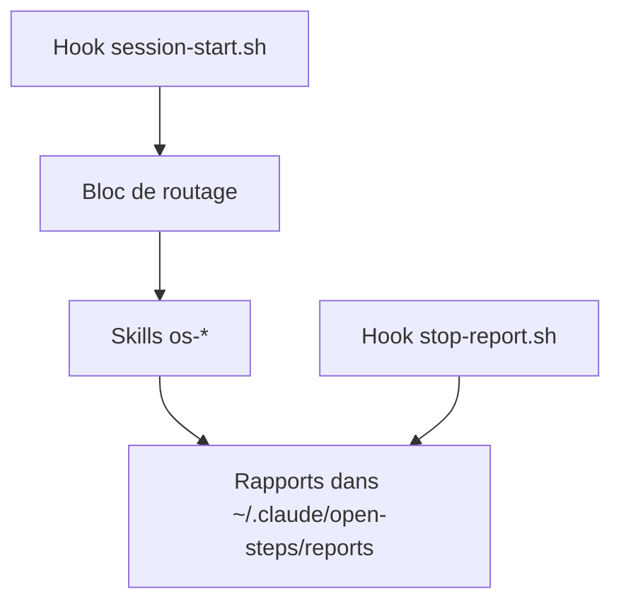

# kharmanskyi/open-steps

> Huit skills d'agent qui font parler Claude Code, Codex, Cursor et Gemini CLI en langage simple.

## Le problème
Les agents rapportent leur travail en hashes et en jargon, et un non-ingénieur ne sait pas si le travail est fini.

## Ce que ça fait vraiment
Huit skills `os-*` : rapport d'une page avec verdict (`os-done-or-not`), étapes pas à pas, questions simples, prémortem, prochaine tâche, vérification du travail d'une autre session, reformulation et `BIG-PICTURE.md`. Deux hooks ouvrent la session avec le tableau de routage et demandent un rapport en fin de travail. Il fusionne seul une pull request aux contrôles verts et approuvée.

## Comment c'est branché
Schéma simplifié d'après la fiche, sans diagramme fourni.



## Essayer
```bash
git clone https://github.com/kharmanskyi/open-steps.git
claude plugin marketplace add ./open-steps && claude plugin install open-steps@open-steps
grep -q 'os-done-or-not' ~/.claude/CLAUDE.md 2>/dev/null || cat open-steps/docs/routing-block.md >> ~/.claude/CLAUDE.md
```

## Coût et pièges
Gratuit. Le bloc de routage s'ajoute à ton `CLAUDE.md`. Il peut exécuter `gh pr merge` sans demande sur Claude Code : écris la note « merge sur commande seulement » pour l'éviter. Les hooks ajoutent du texte au contexte.

## Ce que ce n'est pas
Ce n'est pas un outil qui fait le travail : il change surtout ce que l'agent te dit. Les mesures de l'auteur (trois essais par phrase) sont un test rapide, pas un banc d'essai.

## Alternatives
Aucune alternative nommée dans le README.

## Pour toi
À surveiller : l'idée de rapports courts et vérifiables est bonne pour tes sessions d'agent, mais le merge automatique demande de la prudence.

