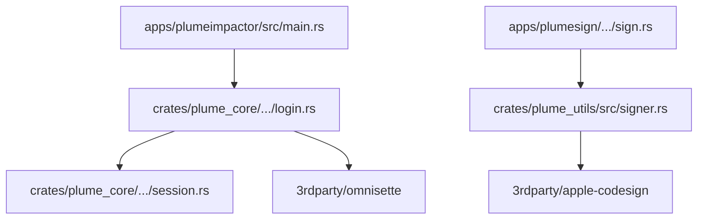

# khcrysalis/Impactor

> Cross-platform application to sign and install iOS apps (sideloading) with an Apple ID.

## The problem
Installing an app on an iPhone outside the App Store requires manually reproducing Xcode's work: certificates, profiles, signing.

## What it actually does
Impactor authenticates with Apple using your account, registers the device, creates a certificate and a profile, then signs the app (apple-codesign) and installs it via idevice. It supports SideStore, LiveContainer, `.deb` and `.dylib` injection, and generates pairing files for other apps. Without a paid developer program, apps expire after 7 days.

## How it is wired


## Trying it
```bash
brew install --cask impactor
```

## Cost and gotchas
Free, but an Apple ID is required. On Windows, iTunes must be installed; on Linux, `usbmuxd` must be running.

## What it is not
Not a tool for data or AI. The limits imposed by Apple (7 days, restricted number of apps) still apply.

## Alternatives
SideStore, AltStore (cited as compatibility targets, not as competitors in the README).

## For you
Ignore: iOS sideloading tool with no link to a data / AI / MLOps profile.
