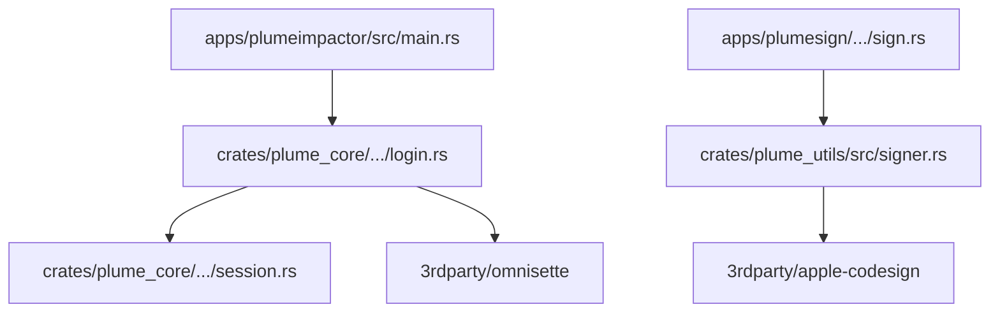

# khcrysalis/Impactor

> Application multiplateforme pour signer et installer des apps iOS (sideloading) avec un identifiant Apple.

## Le problème
Installer sur un iPhone une application hors App Store demande de reproduire à la main le travail de Xcode : certificats, profils, signature.

## Ce que ça fait vraiment
Impactor s'authentifie auprès d'Apple avec ton compte, enregistre l'appareil, crée un certificat et un profil, puis signe l'app (apple-codesign) et l'installe via idevice. Il gère SideStore, LiveContainer, l'injection de `.deb` et `.dylib`, et génère des fichiers d'appairage pour d'autres apps. Sans programme développeur payant, les apps expirent au bout de 7 jours.

## Comment c'est branché


## Essayer
```bash
brew install --cask impactor
```

## Coût et pièges
Gratuit, mais un identifiant Apple est nécessaire. Sous Windows, iTunes doit être installé ; sous Linux, `usbmuxd` doit tourner.

## Ce que ce n'est pas
Ce n'est pas un outil pour la donnée ou l'IA. Les limites imposées par Apple (7 jours, nombre d'apps restreint) restent en vigueur.

## Alternatives
SideStore, AltStore (cités comme cibles de compatibilité, pas comme concurrents dans le README).

## Pour toi
À ignorer : outil de sideloading iOS sans lien avec un profil data / IA / MLOps.

