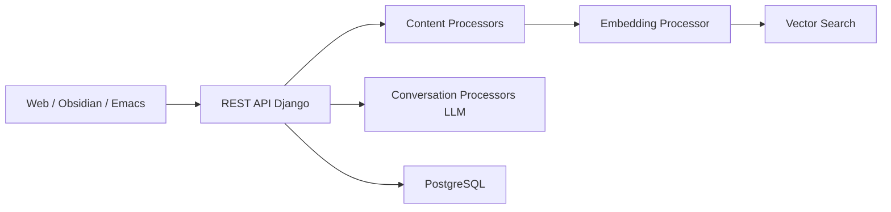

# khoj-ai/khoj

> Personal AI assistant that queries your documents and the web, local or in the cloud.

## The problem
Querying your own notes (PDF, Markdown, org-mode, Notion) with an LLM without copy-pasting everything.

## What it actually does
Django + PostgreSQL backend: per-type document ingestion, embeddings and semantic search, chat with local or remote LLMs (OpenAI, Anthropic, Google...), custom agents, automations (newsletters, notifications), image generation. Web, Obsidian, Emacs, desktop, mobile and WhatsApp clients. The architecture mentions a telemetry system.

## How it is wired

## Trying it
No command in the README: self-hosting is deferred to the documentation, cloud version at app.khoj.dev.

## Cost and gotchas
Freemium cloud, enterprise offer; self-hosted, you provide an LLM API key or a local model. Telemetry is suggested by the architecture, not detailed in the README.

## What it is not
Not a RAG framework to integrate into your code; it is a complete application.

## Alternatives
None named (Pipali is another product from the team).

## For you
Candidate for a self-hosted personal "second brain"; check the telemetry first.
