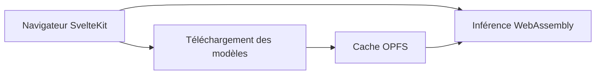

# khromov/nook

> Local AI web application in the browser: chat, transcription, speech synthesis and background removal, without an external server.

## The problem
Use an LLM, Whisper or speech synthesis without sending your data to a third-party service.

## What it actually does
Downloads the models into the browser and runs inference in WebAssembly. Four functions: chat (Gemma3 via llama.cpp), Whisper transcription with subtitle export, voice (Kitten TTS, Piper, Kokoro) and background removal. Models are cached via OPFS, which makes it possible to work offline afterwards.

## How it is wired


## Trying it
```bash
nvm use
npm install
cp .env.example .env
npm run dev
docker build -t nook .
docker run -p 3000:3000 nook
```

## Cost and gotchas
Free. The first launch downloads the models, which is heavy on bandwidth and browser memory. No license is declared: usage and reuse rights are uncertain.

## What it is not
It is not a reusable library: it is an application. Performance depends on the browser's machine.

## Alternatives
No alternative named in the README.

## For you
Worth watching: a useful demonstration of local AI in the browser, but without a license you cannot reuse its code.
