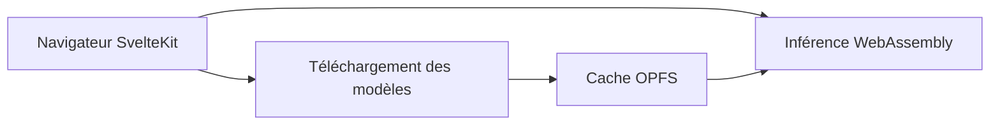

# khromov/nook

> Application web d'IA locale dans le navigateur : chat, transcription, synthèse vocale et détourage, sans serveur externe.

## Le problème
Utiliser un LLM, Whisper ou une synthèse vocale sans envoyer ses données à un service tiers.

## Ce que ça fait vraiment
Télécharge les modèles dans le navigateur et lance l'inférence en WebAssembly. Quatre fonctions : chat (Gemma3 via llama.cpp), transcription Whisper avec export de sous-titres, voix (Kitten TTS, Piper, Kokoro) et suppression d'arrière-plan. Les modèles sont mis en cache via OPFS, ce qui permet de travailler hors ligne ensuite.

## Comment c'est branché


## Essayer
```bash
nvm use
npm install
cp .env.example .env
npm run dev
docker build -t nook .
docker run -p 3000:3000 nook
```

## Coût et pièges
Gratuit. Le premier lancement télécharge les modèles, ce qui est lourd en bande passante et en mémoire du navigateur. Aucune licence n'est déclarée : droits d'usage et de réutilisation incertains.

## Ce que ce n'est pas
Ce n'est pas une bibliothèque réutilisable : c'est une application. Les performances dépendent de la machine du navigateur.

## Alternatives
Aucune alternative nommée dans le README.

## Pour toi
À surveiller : démonstration utile d'IA locale dans le navigateur, mais sans licence tu ne peux pas en reprendre le code.

