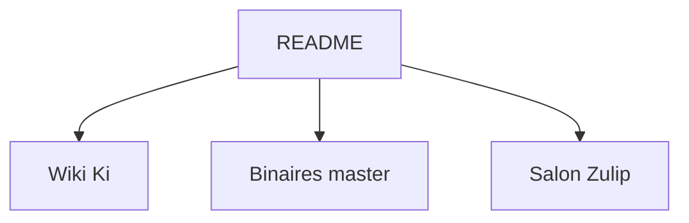

# ki-editor/ki-editor

> Multi-cursor modal text editor, whose README defers everything to the wiki.

## The problem
The README does not say: it only gives the phrase "Multi-cursor combinatoric modal editor".

## What it actually does
Not documented in the README. It describes a multi-cursor modal editor, points to the wiki for installation, build and documentation, offers binaries of the latest release and a Zulip chat room.

## How it is wired
Simplified diagram based on the sheet, no diagram provided.

## Trying it
No command documented in the README: installation is described in the wiki.

## Cost and gotchas
Not documented. Free under the MPL-2.0 license according to the catalog.

## What it is not
It is not an editor documented here: the README does not allow judging its real features.

## Alternatives
No alternative named in the README.

## For you
Ignore for now: the material is insufficient to decide, and a modal editor brings nothing specific to data / AI work.
