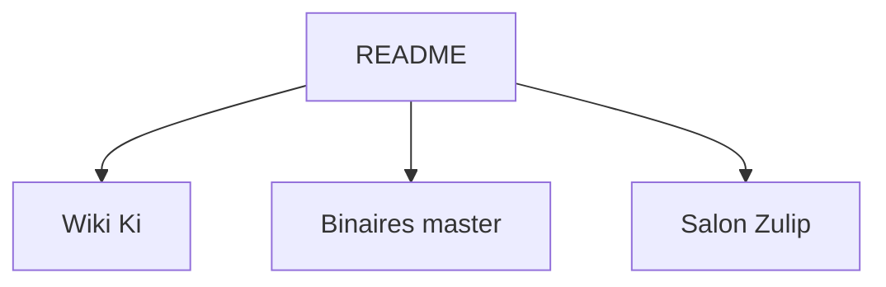

# ki-editor/ki-editor

> Éditeur de texte modal à curseurs multiples, dont le README renvoie tout au wiki.

## Le problème
Le README ne le dit pas : il ne donne que la formule « Multi-cursor combinatoric modal editor ».

## Ce que ça fait vraiment
Non documenté dans le README. Il décrit un éditeur modal à curseurs multiples, renvoie au wiki pour l'installation, la compilation et la documentation, propose des binaires de la dernière version et un salon de discussion Zulip.

## Comment c'est branché
Schéma simplifié d'après la fiche, sans diagramme fourni.

## Essayer
Aucune commande documentée dans le README : l'installation est décrite dans le wiki.

## Coût et pièges
Non documenté. Gratuit sous licence MPL-2.0 d'après le catalogue.

## Ce que ce n'est pas
Ce n'est pas un éditeur documenté ici : le README ne permet pas de juger ses fonctions réelles.

## Alternatives
Aucune alternative nommée dans le README.

## Pour toi
À ignorer pour l'instant : la matière est insuffisante pour trancher, et un éditeur modal n'apporte rien de spécifique à un travail data / IA.

